# ManageAPI

**Manage the AI relays you bought: find out which is cheapest, catch the ones cutting corners, and reach every site through one key.**

Zero dependencies, no build step, fully local. One Node process plus one web page — your data never leaves the machine.

[中文](README.md) · **English**

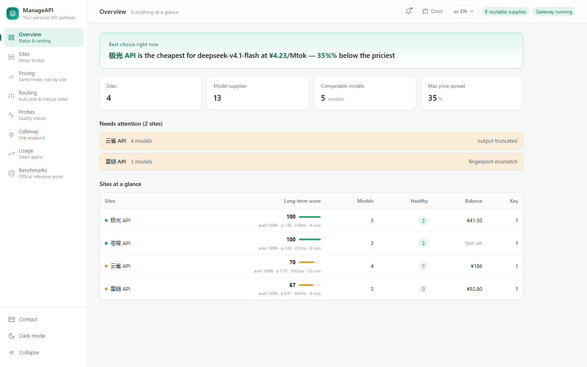

---

## What it solves

If you buy from several AI relays, three things get in the way:

1. **You cannot tell which is cheaper.** Some quote `$2.5/M`, some quote "0.4×", some bill per 1K tokens, others per request or per group. Comparing them means normalising the units first.
2. **You cannot tell whether quality dropped.** The relay is alive, but it quietly forwards your requests to a cheaper model or lowers `max_tokens` so the answer gets cut short. Health checks never catch this.
3. **Switching is tedious.** Every client needs its own base URL and key, and you have to edit each one whenever a site gets cheaper.

ManageAPI addresses these three separately: **price comparison**, **probing**, and a **gateway**.

## Quick start

Requires **Node.js ≥ 20**. No dependencies, no `npm install`.

```bash
git clone https://github.com/ZYH1207/ManageAPI.git
cd ManageAPI
node daemon/index.js
```

Open <http://127.0.0.1:4319/>. The first run creates `~/.manage-api/` with the data directory and an encryption key.

```bash
node daemon/index.js --port 5000   # custom port (walks forward if taken)
node daemon/index.js --open        # open the browser on start
```

**Five steps**

1. Add a relay on **Sites** (the URL must end with `/v1`), paste its key
2. Hit **Sync all**: fetch models, read balance, detect groups in one pass
3. If the group wasn't detected, open the **Group ratios** panel, click **Reload** and pick the tier you actually bought
4. Fill in missing official prices on **Benchmarks**, or load the built-in reference
5. Run one **Probes** pass so the app knows which sites are trustworthy

From then on the gateway picks sites automatically; you can also reorder candidates by hand on **Routing**.

---

## Screens

Nine pages on the left, one job each.

| Page | Purpose |
|---|---|
| **Overview** | Headline conclusion, key stats, sites needing attention, site ranking |
| **Sites** | Balance trend, ratio changes, upstream notices; relay and key management (layout inspired by [bejix/upstream-ops](https://github.com/bejix/upstream-ops)) |
| **Free** | Free models and platform credits, kept out of paid comparison |
| **Pricing** | The same model compared across sites, prices editable inline |
| **Routing** | Candidate order for each model, with manual overrides |
| **Probes** | Fingerprint / truncation / billing / cache checks |
| **Gateway** | One endpoint for all traffic, with a routing log |
| **Usage** | Tokens by day / key / model / site |
| **Benchmarks** | The baseline that ratios convert against |

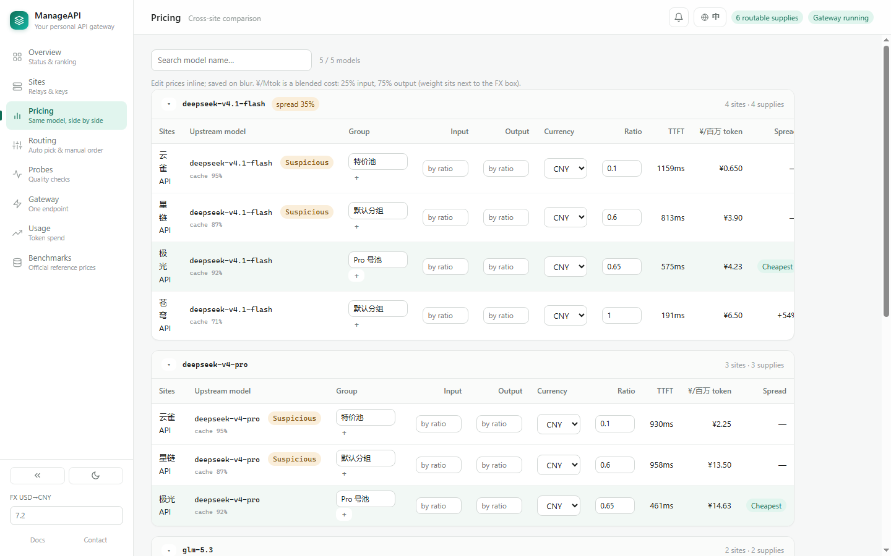

Dark mode, and a bilingual UI (defaults to your browser language, choice stored in `localStorage`):

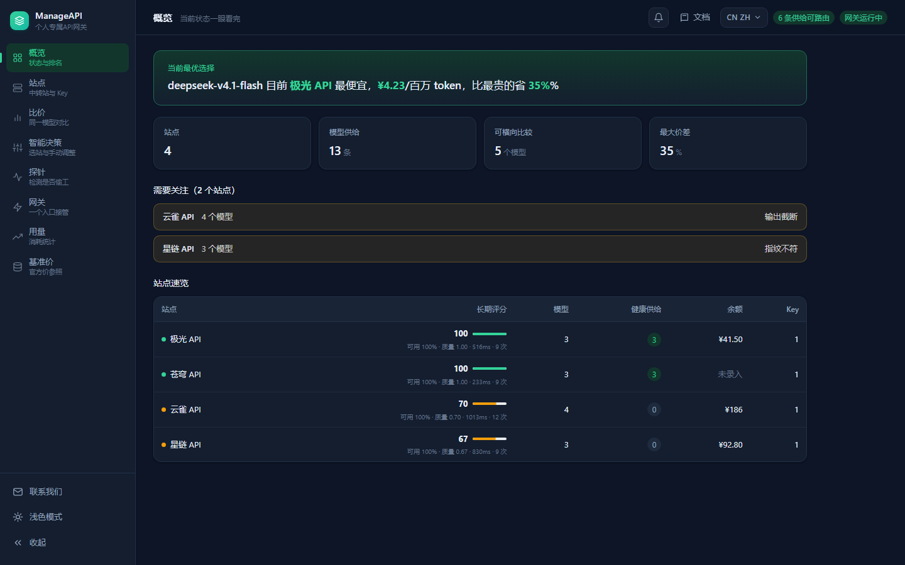

The **Docs** button in the top bar opens the built-in manual, one copy per language with a table of contents. Full Chinese UI: [`screenshot-overview.png`](docs/screenshot-overview.png).

---

## Core concept: groups and ratios

The billing formula is `actual price = model base price × group ratio`. A ratio of `0.1` means 90% off.

**A "group" is the tier you bought.** One site often has a dozen of them — discount pool, Pro pool, enterprise channel, per-request billing. The same model can have a different base price and ratio in each group, so **prices differ by multiples**.

Which group you're in has to come from you: the API can tell which models a key may call, never which tier it belongs to — that is a commercial fact, not a technical one.

Click **Reload** in the **Group ratios** panel of a site card to list every group with its ratio and how many of your models it covers (click it again and it preselects the group you picked last time):

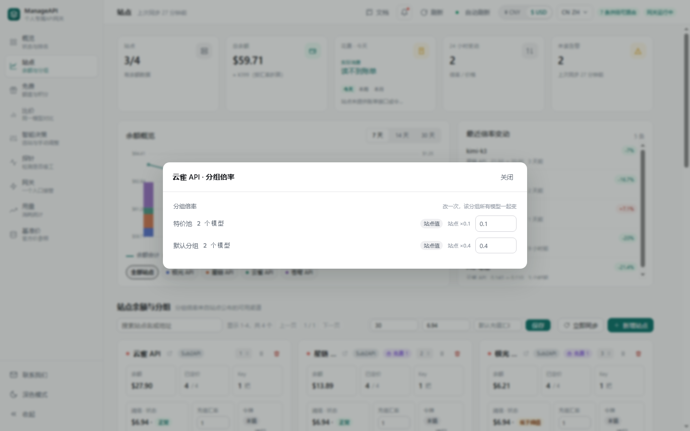

> Group chips are coloured by **vendor**: all domestic vendors blue, OpenAI green, Claude orange, Gemini yellow, **free groups purple** (so "free" reads the same everywhere). Mixed or unrecognised vendors stay neutral grey rather than guess. The ratio digits inherit the group colour and are only bolded; only **markup tiers** warn: >1.2 orange, >2 red.

Data source: with a site **login session** it reads `/api/v1/channels/available` (the richest source, and it does **not** require the site to enable its model plaza); without one it falls back to `/api/v1/model-plaza`.

**Each supply in the pricing table is in one of two modes.** *Ratio* = base price × ratio (unit-price boxes disabled); *Price* = type the input/output unit price directly (ratio box disabled). Switching ratio → price seeds the computed price into the unit box, so the row never turns "unpriced" and disappears.

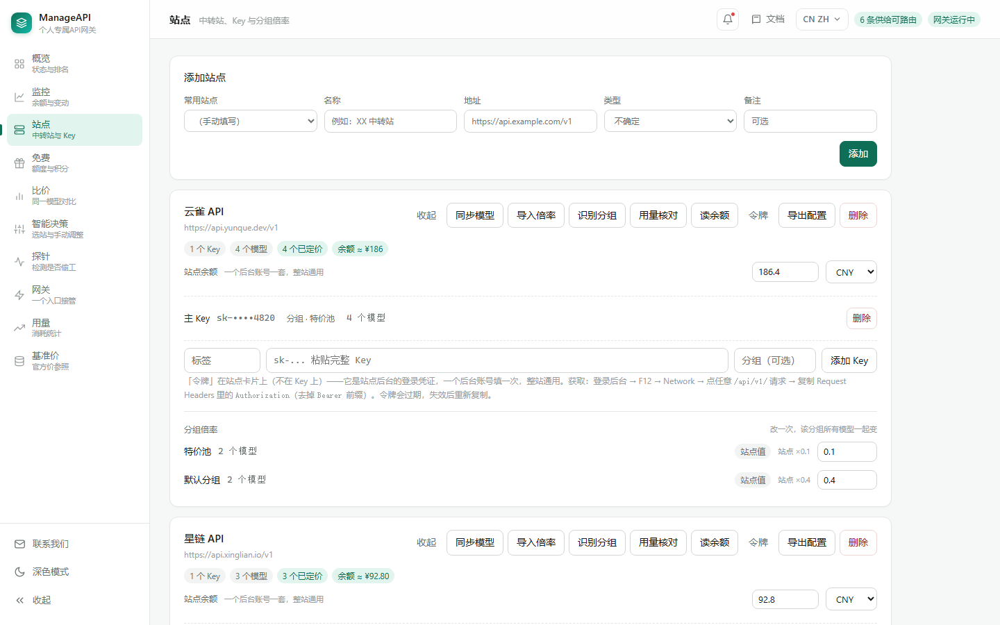

Ratio state is one of three: **site value** (untouched), **custom** (you edited it; the original is shown alongside), **mixed** (individual models in that group were changed). A **Restore** button appears whenever you can go back.

---

## Detecting degradation

The most common relay problem isn't downtime — it's "still works, but no longer the same model".

Each model gets **3–5 requests** (the cache pair only every 6 hours, the identity question only on the first
probe of a supply or a single deep probe), one per trick:

| Trick | Probe | Verdict |
|---|---|---|
| **Swap**: routes to a cheaper model | demand exact output `{"fp":"7Q2K","calc":391}` | exact JSON match |
| **Truncation**: lowers `max_tokens` | ask it to "count to 120" while requesting `max_tokens: 1500` | highest number < 120, or `finish_reason=length` with far fewer tokens than requested |
| **Inflation**: reports far more usage than real | compare `usage.prompt_tokens` with the prompt's actual size | flagged above 3× expected |
| **Cache**: two identical long prompts | read `cached_tokens` on the second | displayed only, never ranked |
| **Self-identification** | ask "what model are you" | **recorded, not scored** — self-reports are unreliable |

All requests are streamed, which also yields TTFT.

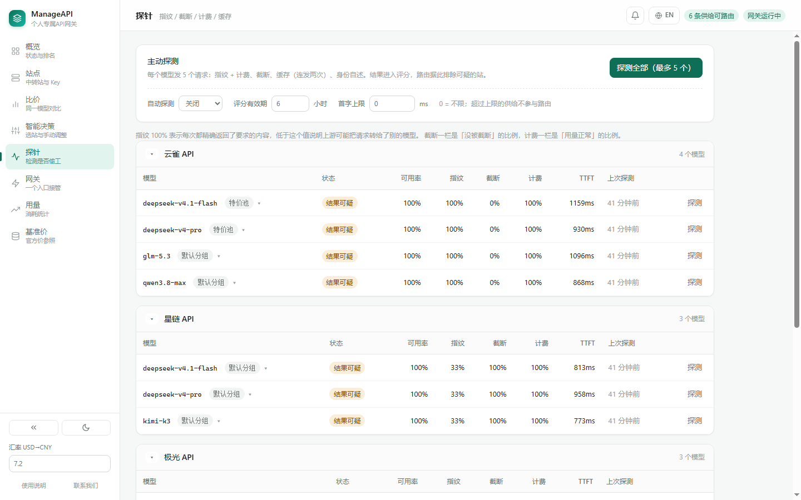

Click any row to expand it and see how the score was computed plus the raw evidence (a swapped site shows the JSON it actually returned).

### Scoring

Two dimensions, **computed separately**, never blended into one weighted sum:

```
availability = (probe success + real traffic success) / (success + genuine failures)
integrity    = fingerprint pass × 0.5 + no-truncation rate × 0.3 + billing-normal rate × 0.2
quality      = availability × integrity
```

**Failures are attributed before they count**: 5xx / timeout / connection errors count as outages; insufficient balance, rate limiting and "model not in this group" **do not** — they become cooldowns (30 / 5 / 60 minutes). Those aren't instability, just this supply being unavailable right now; counting them would paint a pile of merely-unfunded sites red forever and drown out the real 502s.

Either dimension below 0.8 marks the supply unusable — it goes to the back as a fallback.

**Integrity looks only at raw evidence, never at an average**: a fingerprint mismatch is final from one sample (swapping is deterministic); truncation and inflation need 2; empty replies and billing inflation on real traffic need 5 samples with a >20% anomaly rate. Displayed pass rates are smoothed as `(pass+1)/(samples+1)` — **the penalty must match the strength of the evidence**.

> Probes has an **"Allow suspicious supplies"** switch: when on, suspicious supplies compete on effective cost like everyone else (half the quality doubles the cost). The trade-off is that it really may return swapped results — your call.

States: `healthy` routable / `degraded` results untrustworthy / `unstable` genuine failure rate >20% / `inconclusive` not enough evidence / `stale` score expired / `unknown` never probed.

**Scores expire** (6 hours by default) — stale data is more dangerous than no data, because it makes you believe you already checked. Expiry is judged from the last *valid evidence* (probe or real call, whichever is newer), not the last probe.

Auto-probing runs hourly by default and is **adaptive**: healthy sites follow your interval, everything else is re-checked at a third of it (10 minutes minimum).

---

## Effective cost: why division

```
effective cost = nominal price ÷ quality
```

It reads as "what you actually pay for one trustworthy answer". A weighted sum lets "10% cheaper but 30% dumber" win; dividing by quality doubles the cost when quality halves, so cheapness alone can't outrun it.

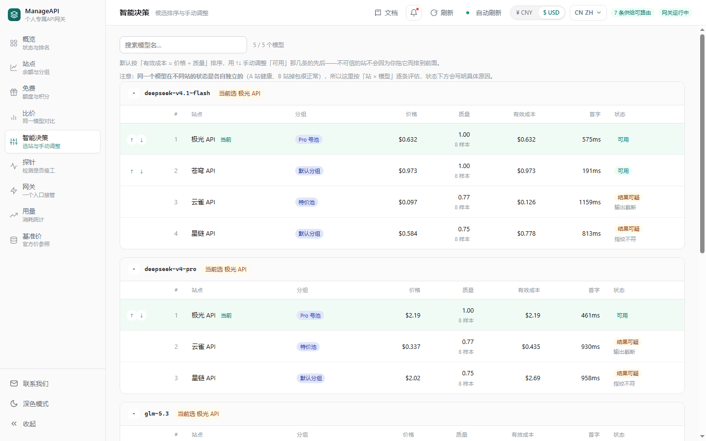

Each row has ↑↓ for manual ordering; the **first row's** button is **Pin** instead — it freezes the current top order into a manual order (manual mode), and clicking it again unpins and returns to automatic ranking. But **availability is a hard judgement that manual order cannot override** — untrusted or stale supplies won't move (enable "Allow suspicious supplies" to let them compete).

TTFT **does not factor into** effective cost (different unit; weighting distorts it). Instead, first-token latency and output speed form a **speed score** — scored against the *usual level* of the same model in the same **chat-length tier** (short: prompt < 60k, medium: 60k–180k, long: ≥ 180k, each tier with its own usual level), then multiplied into quality. There is **no fixed ceiling** any more: a slow supply simply costs more, it is not excluded. When a request has no sample in its own tier it is marked "size not matched" and gets no bonus (score capped at 1.00); with fewer than 3 samples the deviation shrinks towards 1.00, so one sample can move it at most 1/3.

Cache hit rate is **display-only** in this comparison: the benefit depends on your usage pattern — if your chat content never repeats, the rate is 0. Ranking on list price guarantees worst-case cost; cache is a bonus.

The decision page splits first-token latency and output speed into **first token (TTFS)** and **output speed (TPS)** columns, with a **By chat length: [short] [medium] [long]** switch above the table. That switch **only changes the numbers you see, not who gets picked** — routing uses each request's own prompt size to choose its tier.

---

## Free quota: a separate pool

Free relay models and free agent-platform credits live on their own page, **out of paid comparison and out of automatic routing**.

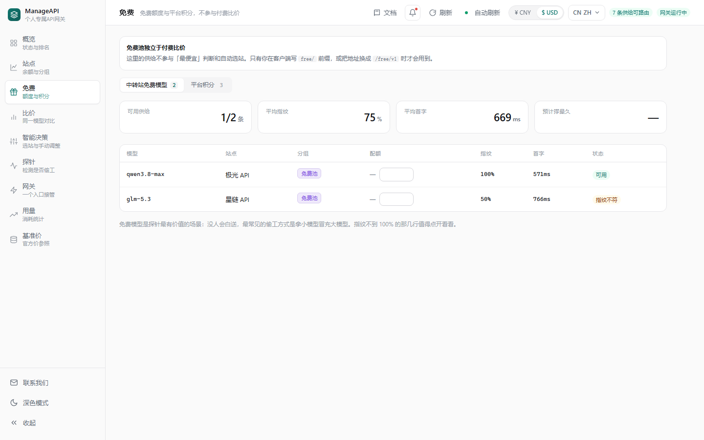

| Pane | What | Gates |
|---|---|---|
| **Free relay models** | Models whose actual price is 0, with quota bars | fingerprint / truncation / quota exhausted / score expired |
| **Platform credits** | WorkBuddy / CodeBuddy / ZCode accounts and remaining credits | quota exhausted / session invalid |

**Why they must be separate**: the paid side can mix freely because every supply shares one comparable metric — effective cost. On the free side the price is always 0, so `0 ÷ quality` is always 0 and weighted ranking collapses. Hence "gate + rank on a single metric": fail a gate and you're out, leaving no room for "cheap but bad".

```bash
base_url = http://127.0.0.1:4319/free/v1      # free only, for the whole client

model = deepseek-v4.1-flash                   # paid pool (same endpoint, mixed)
model = free/deepseek-v4.1-flash              # free pool
```

The prefix can only **upgrade** a request into the free pool, never downgrade it back. When the free pool runs dry the gateway returns `402 free_pool_exhausted` with per-source reset times and **never silently falls back to paid** — that would spend your money behind your back.

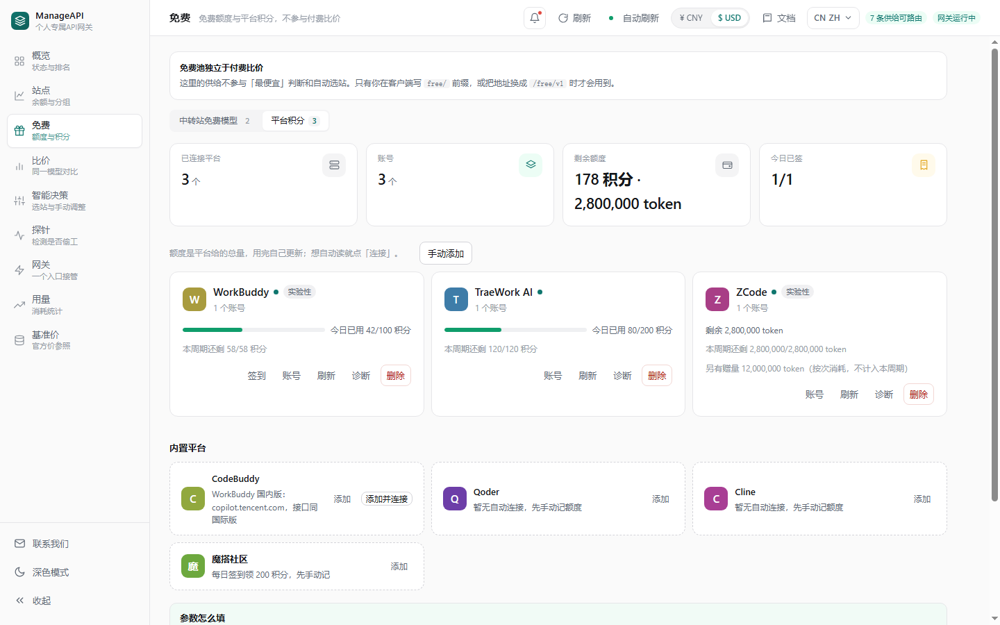

The platform pane supports multiple accounts, daily check-in (idempotent) and quota countdowns. **Only platforms with working auto check-in show the button**, so you can't click into an error. WorkBuddy / CodeBuddy can read credits after **Connect**, marked **experimental** — it uses an undocumented interface meant for their own IDE, so a platform update may break it; when it breaks you just lose the numbers.

ZCode (Zhipu) takes a different route: its authorisation is a desktop scheme `zcode://…`, so instead of simulating login it **reads the local ZCode client's session** to obtain a JWT and call the plan API. Real credentials stay in the client. Quota is reported in two separate figures — "this cycle" and "one-off grants" — and the card spells both out.

---

## Gateway: one key for every site

In your client:

| Field | Value |
|---|---|
| Base URL | `http://127.0.0.1:4319/v1` |
| API Key | the `sk-mapi-...` shown on **Gateway** |

Set `model` to the normalised name (`GET /v1/models` lists them). You never touch upstream keys again.

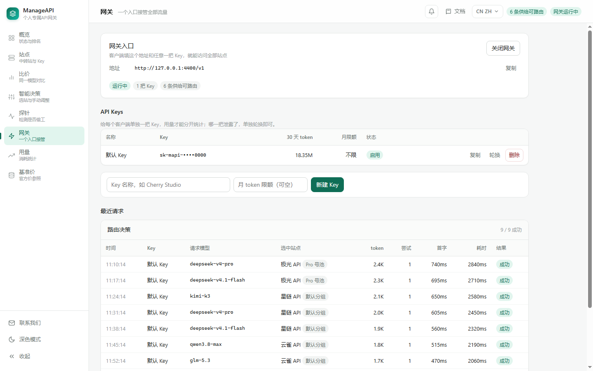

**Selection order**: drop untrusted / expired → sort the rest by effective cost → if the first one fails, switch to the next **before** answering the client.

The streaming boundary that matters: **the first chunk must be read and confirmed not to be an error before committing response headers**. Any failure before that switches silently; after that there is only a graceful finish.

Response headers carry `X-ManageAPI-Provider` / `X-ManageAPI-Attempts` / `X-ManageAPI-Quality`. The gateway page keeps a routing log: who served each request, how candidates were ranked, why attempts failed. Its result column has three outcomes: **success**, **delivered · client hung up first**, and a red failure reason. The middle one means the upstream already finished the whole turn (it sent `finish_reason` and `usage`, so the content and the token accounting are complete) and the client — DSH, say — disconnected after the tool call without waiting for the final `[DONE]`; it counts as a success and does not lower availability.

**How usage is obtained**: clients rarely send `stream_options.include_usage`, so the gateway **injects** it and then **filters out** the trailing usage-only chunk before forwarding. The client's stream is unchanged; the gateway gets exact numbers.

Give each client its own key so usage can be attributed, and set a monthly token cap per key (returns 429 above it).

---

## Usage

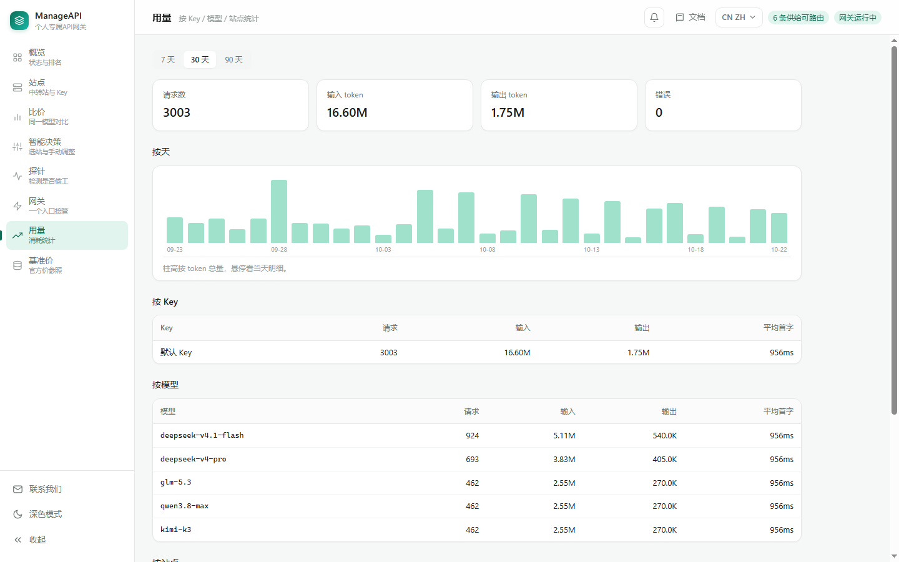

Aggregated by "day × key × site × model" into its own `usage.json` (the only data that keeps growing — mixing it into the config file would slow every settings write). Four views: daily bars, by key, by model, by site, switchable across 7 / 30 / 90 days.

**Only traffic through the gateway is counted.**

The refresh button in the top bar is a **full refresh**: besides state, it re-reads the overview's balances and real spend (bypassing the 60-second cache), the monitor data, and the usage page's currently selected range. The 15-second auto-poll stays light and only pulls state.

---

## Monitoring

Comparison and probes answer "which site is best right now"; monitoring answers "what happened these past days".

Collection runs every 30 minutes by default (can be turned off). It only reads site APIs and burns no tokens, so it can be more frequent than probing:

- **Balance** — via the site's dashboard API; requires a **site login session** first (Account login, or Import session with the login-response JSON; after that the refresh token renews it automatically). When unreadable it says "no data" rather than inventing a number.
- **Actual spend** — read **straight from the site's own bill** (`/api/v1/usage`, summing `actual_cost` per request). Why not the gateway's estimate: about **26% of tokens never arrive with `usage`** (requests that don't return it can only be recorded as 0), and `cached_tokens` is unstable (same site, same day: sometimes 553216, sometimes 128). Together those put estimates anywhere from 7× to 10× off. An unreadable bill shows **"not collected"** plus the actual reason: *N sites have an expired login session, renew to read their bills* (the card then offers **Renew all**, which renews each one and re-collects), *no site login yet: sign in on the Sites page first*, or *some sites expose no billing API*. Collection failures are no longer silent either: an expired token / no permission is recorded as "bill: &lt;reason&gt;" and the site is marked session-invalid.
- **Auto-renewal at collection time** — when the 30-minute collection hits a 401/403 it renews the session once by itself and re-reads that round's bills, no manual step needed.
- **Group ratios** — from `/api/v1/channels/available`, which also brings back model base prices.
- **Upstream notices** — `/api/status` and `/api/v1/announcements`, deduplicated by title + publish time.

**Alerts are cooled down per "site × type"** — the same low balance is recorded once per six hours. The first collection only records a baseline and raises no changes, otherwise onboarding floods you with "new".

---

## Data and security

Everything lives in `~/.manage-api/`:

| File | Contents |
|---|---|
| `db.json` | Sites, credentials (encrypted), supplies, prices, probe records, monitoring history |
| `master.key` | AES-256-GCM key, generated on first run, mode 0600 |
| `benchmark.json` | Baseline price table, hand-editable |
| `free.json` | Free-pool platform accounts and credit ledger |
| `usage.json` | Usage aggregates (grows over time) |

`MANAGE_API_HOME=/path/to/data node daemon/index.js` relocates it.

**Automatic backups**: on start and every 24 hours the data is copied to a sibling `manage-api-backups/`, one timestamped directory per run, keeping the latest 30 (`MANAGE_API_BACKUP_KEEP`). **Restore requires `db.json` and `master.key` as a pair** — restoring only the db leaves every key undecryptable. Backups contain `master.key` and are as sensitive as the original data: never commit them, never put them on public storage.

**Single instance**: `daemon.lock` records PID and port; a second instance exits immediately.

**Access control**: the server binds `127.0.0.1` only and validates the `Host` header against `127.0.0.1` / `localhost` / `[::1]` — that guards against DNS rebinding. Write endpoints additionally require `Content-Type: application/json`. So **do not expose it through a reverse proxy**: the Host check returns 403 on purpose.

**Threat model**: key encryption protects against leaked backups, files sent to the wrong place, and accidental commits. It does not protect against a compromised machine — the key sits in the same directory.

---

## Known limitations

- **Balance and billing both need a site login session.** one-api's `/api/user/self` and sub2api's `/api/v1/usage` want a login session, not an `sk-` key, and many sites disable such endpoints. Connect the site once with **Account login** (or **Import session**); after that an expired session **renews itself** (refresh token first, falling back to a fresh account/password login), and sites that cannot auto-renew say why on the card. When it can't be read you get "no data" / "not collected" — the tool won't guess.
- **Only `/v1/chat/completions` and `/v1/models` are proxied.** Embeddings and images are not implemented.
- **Usage depends on upstream returning `usage`.** A few sites refuse even when asked; those requests record 0 tokens but still count as requests. A request the client cut short *after* upstream had delivered the whole turn is recorded as **"delivered · client hung up"**, and its `usage` and first-token time still count (long conversations almost always end this way — throwing them away would leave the long-chat bucket with no data forever).
- **A probe proves "not slow", never "fast".** A probe is a 45-token request plus a 14.5k cache pair every 6 hours; a real 200k-token conversation waits 2.6–11.9× longer for its first token. Speed scoring therefore prefers real traffic samples and compares **within prompt-size buckets** (60k / 180k boundaries); with fewer than 3 samples in a bucket the deviation is damped toward 1.00, and a bucket with no samples gets no bonus. New sites, and sites whose context size just changed, look conservative.
- **One "Probe all" click covers at most 20 models**: it always starts with the ones probed longest ago and skips sites in cooldown, so two clicks sweep everything.
- **Per-request supplies don't compete for "cheapest"** (different unit). Billing mode is detected from the plaza's `billing_mode`; without a plaza you can set the unit to `/call` yourself.
- **Only one instance at a time.**

---

## Development

No build step: edit the front end and refresh; restart the process for back-end changes.

```bash
node .test/run-monitor.mjs     # self-contained: spins up a fake upstream, runs, exits
node .test/check-fx.mjs        # FX: auto / manual / failure fallback (fake fetch, offline)
node .test/run-e2e.mjs         # end-to-end probing (needs 3 fake sites + a 4399 instance)
node .test/run-gateway.mjs     # gateway: routing, failover, streaming, auth
```

`core/` has no host dependencies and can be reused on its own. See [`docs/`](docs/) for design documents and `package.json` for the full script list.

Regenerating the screenshots:

```bash
MANAGE_API_HOME=/tmp/showcase node .test/seed-showcase.mjs
MANAGE_API_HOME=/tmp/showcase node daemon/index.js --port 4400
chrome --headless=new --remote-debugging-port=9222 about:blank &
node .test/capture-shots.mjs                    # SHOT_LANG=en for the English set
```

The site names in the showcase data (云雀 / 星链 / 极光 / 苍穹) are fictional.

---

## Credits

- [bejix/upstream-ops](https://github.com/bejix/upstream-ops) — the site-card layout (channel cards, group chips, toolbar) and the low-saturation group/ratio colouring are inspired by this project. Only the layout and colour approach are borrowed; data and interactions are implemented here. Thanks to the author.

## Feedback

- Issues: <https://github.com/ZYH1207/ManageAPI/issues>
- QQ group: 361801207
- Email: <2385377554@qq.com>
- Blog: <https://zyh1207.github.io/>

## License

[MIT](LICENSE)
