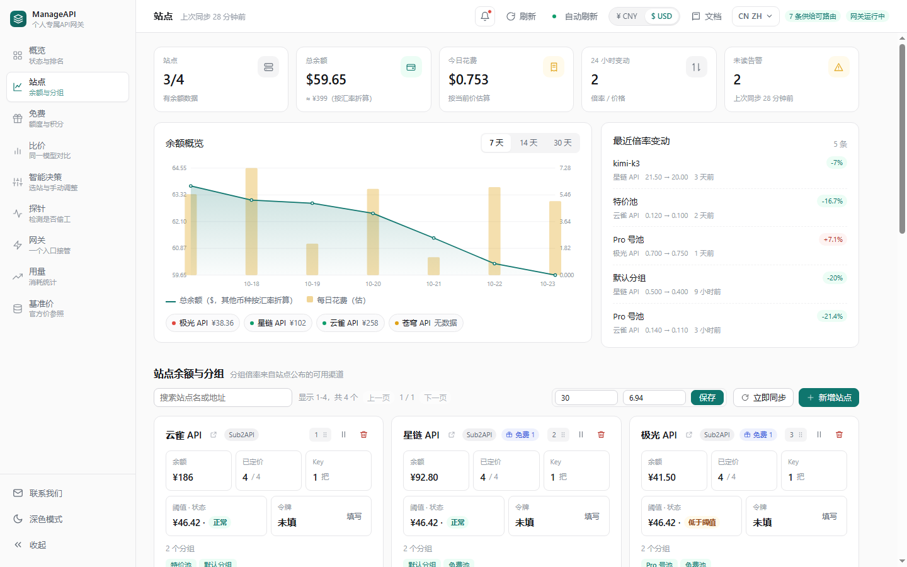

# ManageAPI

**管理你买的多个 AI 中转站：算清哪家最便宜、盯住哪家在偷工、用一个 Key 走全部站点。**

零依赖、零构建、纯本地。一个 Node 进程 + 一个网页，数据不出本机。

**中文** · [English](README.en.md)


> 界面支持中英切换（顶栏右上角的下拉），选择记在浏览器里。
> 下图是英文模式：
>
> 

---

## 快速开始

需要 **Node.js ≥ 20**，没有其他依赖，不用 `npm install`。Windows / macOS / Linux 都能跑，代码里只有「打开浏览器」这一处区分平台。

```bash
git clone https://github.com/ZYH1207/ManageAPI.git
cd ManageAPI
node daemon/index.js
```

浏览器打开 <http://127.0.0.1:4319/>。

可选参数：

```bash
node daemon/index.js --port 5000   # 指定端口，被占用会自动往后找
node daemon/index.js --open        # 启动后自动开浏览器
```

首次启动会在 `~/.manage-api/` 生成数据目录和加密密钥。

### 五步上手

1. **站点**页添加中转站（地址结尾要带 `/v1`），粘贴它的 Key
2. 点 **一键同步**：拉模型、读余额、识别分组一次跑完（没填「令牌」时跳过识别分组）
3. 没认出分组就点 **导入倍率**，在弹出的分组列表里选你实际买的那一档
4. 缺官方价的模型，去 **基准价**页补上，或者载入内置参考价
5. 去 **探针**页跑一次检测，让程序知道哪些站可信

之后网关就会自动选站了；也可以在 **智能决策**页手动调整先后。

## 它解决什么问题

同时买了几个中转站的人都会遇到这三件事：

1. **算不清哪个划算。** 有的标 `$2.5/M`，有的标「0.4 倍」，有的按千 token 计，还有按次、按分组打折的。放到一张表里比，得先把计价口径统一。
2. **不知道有没有降智。** 站还活着，但悄悄把请求转给了便宜模型，或者压低 `max_tokens` 只吐一半。这类问题探活接口查不出来。
3. **切换很烦。** 每个客户端都要配一份 base_url 和 Key，哪家便宜就得挨个改。

ManageAPI 针对这三点，分别做了**比价**、**探针**、**网关**。

---

## 界面

左侧九页，每页一件事：

| 页面 | 用途 |
|---|---|
| **概览** | 一句话结论、关键指标、需要关注的站、各站速览 |
| **站点** | 余额曲线、倍率变动、上游公告；站点与 Key 的管理也都在这页（版式参考 [bejix/upstream-ops](https://github.com/bejix/upstream-ops)） |
| **免费** | 中转站免费模型与平台积分，独立成页、不参与付费比价 |
| **比价** | 同一模型跨站对比，行内改价 |
| **智能决策** | 路由候选排序，可手动上下调整 |
| **探针** | 指纹 / 截断 / 计费 / 缓存四项检测 |
| **网关** | 一个入口接管全部流量，含决策日志 |
| **用量** | 按天 / Key / 模型 / 站点统计 token |
| **基准价** | 倍率换算的参照表 |

> 站点页的卡片式布局（渠道卡、分组胶囊、工具栏）参考了 [bejix/upstream-ops](https://github.com/bejix/upstream-ops) 的设计：只借版式，数据与交互都是本项目自己实现的。谢谢作者。

顶栏右侧是通知、文档入口和语言下拉；侧边栏底部固定三个入口：联系我们、深色模式、收起。

支持深色模式（深蓝底 + 薄荷绿）：


界面中英双语，顶栏下拉切换，偏好存在 `localStorage`。默认跟随浏览器语言（中文环境给中文，其余给英文）。


顶栏的「文档」打开内置使用说明，中英各一份，左边带目录：


---

## 核心概念：分组 + 倍率

中转站的计费公式是：

```
实际价格 = 模型原价 × 分组倍率
```

倍率 `0.1` 就是打一折，`0.3` 是三折。

**「分组」就是你买的那一档套餐。** 一个站常常有十几个分组——特惠池、Pro 号池、企业通道、按次计费、某个模型专用的高价组。同一个模型在不同分组里，原价和倍率都可能不一样，**价格能差好几倍**。

所以「你在哪个分组」必须由你告诉工具：API 只能说明「这把 Key 能调用哪些模型」，不会说明「它属于哪一档套餐」——那是商务事实，不是技术信息。

> 界面上的分组胶囊按**厂商品牌色**着色：国产厂商统一用 DeepSeek 的蓝色；OpenAI 绿、Claude 赭橙、Gemini 黄各自一色；**免费分组用紫色，与站点卡「免费 N」标记同款**（跨页面认「免费」）；混合厂商或识别不出的保持中性灰、不猜。胶囊内的倍率数字（如 `特价池 ×0.15`）与分组文字同色、仅加粗，只有**加价档位**才示警：>1.2 橙、>2 红。呈现规则（低饱和底 + 同色文字）参考了 [upstream-ops](https://github.com/bejix/upstream-ops)。

### 导入倍率

站点卡片上点 **导入倍率**，会列出该站所有分组，每个后面标着倍率和能覆盖你几个模型，能用的排在前面：


选中你买的那一档 → **应用倍率** → 倍率写进下面所有模型，比价 / 决策 / 路由立刻同步。选中的分组会记在这把 Key 上，下次打开默认选中。

数据来源：有「令牌」时读 `/api/v1/channels/available`（Sub2API 的可用渠道接口，数据最全，**不要求站点开启模型广场**）；没令牌则回落 `/api/v1/model-plaza`。

### 自定义倍率与恢复


「分组倍率」那几行：

- 标 **站点值** —— 和站点公布的一致，没动过
- 标 **自定义** —— 你手改过，旁边会写出站点原本是多少
- 标 **混合** —— 这个分组下模型倍率不一致（单独改过某几个）
- 出现 **恢复** 按钮时点一下回到站点值；顶部 **全部恢复为站点值** 是整个站一起还原

改倍率有实际用处：比如站方标 0.15，但你用「用量核对」算出实际扣费相当于 0.18，就手动改成 0.18，比价结果才准。

### 比价表：倍率还是价格

每条供给有「模式」一列，二选一：

- **倍率** —— 实际价 = 基准价 × 倍率；此时输入价 / 输出价输入框禁用，避免两套口径打架
- **价格** —— 直接填输入 / 输出单价；此时倍率输入框禁用

从「倍率」切到「价格」时，程序会把当前折算价写进单价框，这条供给不会因为切模式变成「未定价」从表里消失。

缓存命中率是单独一列，来自最近一次探针；没探过显示「—」。综合成本下方的小字才是空闲时段价。

### 基准价

倍率要换算成钱，得有个参照物。三个来源：

| 来源 | 说明 |
|---|---|
| **从站点导入官方价** | 拉取站方标注的模型原价，只补空缺不覆盖 |
| **以此站已填价为准** | 把你确信没虚标的那个站的实际价整体设为基准 |
| **载入内置参考价** | 内置一份各家官方价，冷启动用，**变动频繁务必核对** |

内置价只补空缺，来源列标 `reference:`，方便分辨。

这一页底部还有两个参数：

- **显示币种（USD / CNY）**：只影响价格怎么显示。所有比较（最便宜、价差、智能决策、有效成本）内部一律按**美元/百万 token** 算，所以切币种不会改变结论，只是换个读法。
- **汇率（USD→CNY）**：默认自动拉取（`open.er-api.com`，失败时回退 `api.frankfurter.app`），每 12 小时更新一次，下面会写「自动 · 3 小时前更新」；超过 7 天没更新会标黄。手工改这个输入框就切到**手动模式**（不会再被自动覆盖），旁边出现「恢复自动」按钮切回去。只在「人民币标价的站」折算成美元、以及把美元显示成人民币时用到。拉取失败一律沿用上一次的值，不影响任何功能——离线也能用。

> 为什么基准是美元：中转站绝大多数按美元标价，用人民币当基准要先乘一次汇率，汇率一变历史榜单和「最便宜」的文案就跟着变；而价格 ÷ 质量这类判断本来就和币种无关。

> 注：模型广场里另有一个 `official_pricing` 字段，实测不少站把它填成同一个占位值（比如所有 deepseek 模型都报 0.15），所以工具不用它，只用 `pricing`（站方原价）。


---

## 降智检测

中转站最常见的问题不是挂掉，是「还能用，但已经不是原来那个模型了」。

每个模型发 **5 个请求**，分别对应几种偷工方式：

| 偷工方式 | 检测手段 | 判定依据 |
|---|---|---|
| **掉包**：转给便宜模型 | 要求精确输出 `{"fp":"7Q2K","calc":391}` | 返回的 JSON 是否精确匹配 |
| **砍额度**：压低 `max_tokens` | 要求「数到 120」，同时请求 `max_tokens: 1500` | 最高数字 < 120，或 `finish_reason=length` 但 token 数远低于请求值 |
| **虚报**：用量远大于实际 | 对比 `usage.prompt_tokens` 与提示词实际规模 | 超过预期 3 倍即标记 |
| **缓存**：连发两次相同长前缀 | 看第二次的 `cached_tokens` | 只展示，不参与排序 |
| **身份自述** | 问它「你是什么模型」 | **只记录不评分**——模型自述本来就不可信，拿来扣分误伤太多 |

全部走流式请求，顺带拿到 TTFT（首 token 延迟）。


点表格里任意一行会展开，能看到分数怎么算出来的，以及最近一次探测的原始证据——掉包站会显示「实际返回 `{"fp":"XX99","calc":0}`」，砍额度站会显示「最高数字 41，finish_reason=length」。

### 评分怎么算

两个维度**分开算**，不揉成一个加权和：

```
可用率 availability = (探针成功 + 真实流量成功) / (成功 + 真正的故障)
完整性 integrity    = 指纹通过率 × 0.5 + 未截断率 × 0.3 + 计费正常率 × 0.2
质量     quality    = availability × integrity
```

**失败要先归因，再决定算不算账**（`core/failure.js`）：

| 上游返回 | 算故障吗 | 处理 |
|---|---|---|
| 5xx、超时、连接失败、返回的不是 JSON | 算 | 拉低可用率 |
| 余额不足 / 预算超限（402、403 `INSUFFICIENT_BALANCE`） | 不算 | 冷却 30 分钟 |
| 限流（429） | 不算 | 冷却 5 分钟 |
| 模型不在这个分组（404 `model not supported` / `not in group`） | 不算 | 冷却 60 分钟 |

「不算」的这几类不是站点不稳，而是这条供给此刻拿不到：充上余额、等限流过去、换个分组就恢复。把它们算成故障，一堆只是没额度的站会长期挂红，真正的故障（502、卡死）反而被淹掉。冷却期内不参与路由，冷却结束、或之后有一次成功调用就自动回来——界面标成「额度不足 / 限流中 / 模型不可用 · 冷却中」，而不是「不稳定」。

任一维度低于 0.8 就标记为不可用，默认排到最后只做兜底。

**完整性（结果可不可信）怎么判**——只看原始证据，不看平均分：

| 项 | 判定 | 理由 |
|---|---|---|
| 指纹不符 | **单次即判** | 掉包是确定性的，网络抖动不会让答案变成别的数 |
| 输出截断 / 用量虚报 | **2 个样本才判** | 一次可能是流被切断，不一定是站的问题 |
| 真实响应异常（空回答 / 计费虚报） | **5 个样本、异常率 >20% 才判** | 网关只能验这两类客观异常，门槛要高 |

显示用的通过率按 `(通过+1)/(样本+1)` **平滑**：样本越少越接近 100%，样本多了才收敛到真实值。这样一次探针异常只会让质量轻微下降（几个百分点），而不是把质量砸到 0.5 让有效成本翻倍——**惩罚力度必须和证据强度匹配**。

> **想让可疑的站也能用？** 探针页有个 **「放行可疑供给」** 开关。打开后，指纹不符 / 截断 / 虚报 / 评分过期的供给不再被压到后面，而是和健康的站一起按有效成本竞争——质量差一半成本就翻倍，所以只有便宜到足够多才会被选中。代价是它确实可能返回掉包或截断的结果，开关由你自己权衡。首字上限是独立设置，不受影响。

状态：

- `healthy` —— 两个维度都达标，可参与路由
- `degraded` —— 连得上但结果不可信（掉包 / 截断 / 虚报），单次即判
- `unstable` —— 真正的故障率超过 20%，且样本 ≥ 3
- `inconclusive` —— 有失败但样本不足 3，判「证据不足」：不参与路由，但不标红、不催你修
- `stale` —— 评分超过有效期，需要重新探测
- `unknown` —— 还没探过，或只有额度类失败（没有可靠性证据）

### 评分会过期

默认有效期 6 小时，可在探针页调整。过期后不再参与路由——**过期数据比没有数据更危险**，因为它会让你误以为已经检查过了。

**「过期」看的是最后一次有效证据，不是最后一次探针。** 探针和真实调用都是证据，取最近的那一次：

- 7 小时没被探过、但 10 分钟前刚被真实调用过 → **不算过期**，而且那条失败记录会如实反映成「不稳定」，不会被「过期」盖住
- 7 小时没被探过、也没有任何真实流量 → 过期
- 流量记录本身超过 1 小时窗口 → 不算证据（那是上一轮的历史，不是现况）

两个时钟必须自洽：有效期决定「允许错过几轮探测」，**探测间隔不能超过有效期的一半**（改设置时会直接拒绝），否则每条供给都会在两轮探测之间整段过期——这正是当初「间隔和有效期都设成 6 小时」踩过的坑。

这也是自动探测存在的理由：没有定时探测，评分迟早全部过期，路由退化成纯按价格选。

探针页可设自动探测间隔（默认 1 小时，可关）。调度器每分钟检查一次，挑出到期的供给（最多 10 个）去探。用「检查 + 到期判断」而不是长间隔定时器，改配置立即生效，一次探测耗时长也不会错过下一轮。

间隔是**自适应**的：健康的站按你设定的间隔，其它站（不健康 / 证据不足 / 过期 / 完整性有疑点 / 从没探过）按 1/3 间隔补测（最少 10 分钟）——问题站点应该尽快拿到新证据，而不是等一整轮。冷却中的供给直接跳过（探了也是白探）。一轮里最多 4 个并发，避免串行跑满超时把整轮拖成几十分钟。

### 样本量决定置信度

`healthy` 是「按现有证据它没问题」，不是「已验证可靠」——1 个样本的成功和 10 个样本的成功都叫 healthy，但确定性差很多。所以每条供给带一个**置信度**：

| 样本量（探针 + 真实调用） | 置信度 |
|---|---|
| ≥ 10 | 高 |
| 3 – 9 | 中 |
| < 3 | 低（界面上会标出「N 样本」） |

置信度只做展示，不改变放行规则——样本少不代表不能用，只代表「还没测够」。

### 真实流量也算数

探针是模拟请求，测不出「高峰期 5xx」。所以网关每次转发的成败也会累计到对应供给上，和探针一起算可用率；失败同样先归因，额度/限流不进可用率。

实测：一个站探针正常，连续 3 次真实请求失败后可用率从 100% 掉到 63%，状态变 `unstable`，下次路由就跳过它。流量计数按 1 小时窗口滚动（读写两端都校验窗口）——上午挂了下午恢复的站，不该被上午的失败一直拖累。

网关还会对**成功的真实响应**做两类客观质量抽样：**空回答**（200 成功、正常结束却一个字都没有）和**计费虚报**（上报的 `prompt_tokens` 超过请求体估算的 4 倍，只抓明显异常）。指纹和截断需要受控 prompt，真实请求里验不了——那两项只有探针能做。抽样结果按 5 个样本、20% 异常率的门槛才影响评分，不足就只记录。

---

## 有效成本：为什么用除法

```
有效成本 = 名义价格 ÷ 质量
```

直观含义是「为一份可信输出实际付了多少钱」。

为什么不用加权求和？因为「便宜 10% 但降智 30%」的站，加权后可能仍然胜出；而除以质量之后，质量掉一半成本就翻倍，再怎么便宜也压不住。这个公式还天然可解释。

决策页就是这么排的——名义价 ¥0.65 的站被 ¥4.23 的站顶掉，因为它被判「结果可疑」：


### 手动干预

纯自动有个问题：**你没法表达「我就想用这家」**。所以每行前面有 ↑↓，可以调整顺序。

手动顺序只作用于「可用」的那几条：

- 不可信 / 太慢 / 过期的供给默认排在后面，拖不动它——**可用性是硬判断，不能被手动覆盖**（想让它们参与竞争，去探针页打开「放行可疑供给」）
- 新出现的供给如果不在手动顺序里，按自动排序追加在后面
- 点「恢复自动」清掉手动顺序

### 首字延迟

延迟**不参与**有效成本排序——它和价格量纲不同，加权会失真。取而代之的是一个可选上限：探针页设「首字上限」，超过的供给不参与路由，比价表里标「超时」，同时取消它的「最便宜」标记。

想省钱就让慢站参与，赶时间就设个上限，规则简单可预期。

### 缓存命中只展示、不折算

中转站普遍对缓存命中的输入 token 打 1-2 折。检测方法是同一段 1200+ token 的前缀连发两次，只看第二次的 `cached_tokens`（中间留 1.5 秒让上游写缓存）。

**这一项不参与排序。** 缓存收益取决于你的使用模式——请求前缀都不重复的话命中率就是 0，那个「便宜」对你没意义。用标价排序保证最坏情况下的成本，缓存算额外红利。

---

## 免费额度：另一个池子

中转站的免费模型和 Agent 平台的免费积分，收在一个独立页面里，**不参与付费比价，也不参与自动选站**。


页内用顶部切换分两栏：

| 栏 | 看什么 | 闸门 |
|---|---|---|
| **中转站免费模型** | 实际价为 0 的模型，含配额进度条 | 指纹 / 未截断 / 额度耗尽 / 评分过期 |
| **平台积分** | WorkBuddy / CodeBuddy / ZCode 等平台的账号与剩余积分 | 额度耗尽 / 会话失效 |

**为什么必须分开**：付费侧能混排，是因为所有供给有共同的可比指标——有效成本。免费侧价格恒为 0，`0 ÷ 质量` 永远是 0，加权排序会直接失效。所以免费侧用「**闸门 + 单指标排序**」：质量不达标就整个排除，不给「便宜但烂」留位置。

**怎么用**：

```bash
# 整个客户端只用免费
base_url = http://127.0.0.1:4319/free/v1

# 或者混着用，模型名前缀区分
model = deepseek-v4.1-flash        # 付费池
model = free/deepseek-v4.1-flash   # 免费池
```

前缀只能把请求「升级」到免费池，不能降级回付费，所以两种入口不会冲突。免费池用尽时返回 `402 free_pool_exhausted` 并列出各来源的重置时间，**不会静默回落到付费**——那等于背着你花钱。


平台侧支持多账号、每日签到（幂等，同一天只成功一次）和额度倒计时。**只有实现了自动签到的平台才显示「签到」按钮**：WorkBuddy / CodeBuddy 会真实请求平台接口，成功才写账本；手动平台和 ZCode 没有自动签到，按钮不出现，省得点了报错。WorkBuddy / CodeBuddy 支持点「连接」后自动读积分，标了**实验性**——它走的是平台给自家 IDE 用的未公开接口，平台升级可能失效；失效时只是读不到数据，不影响别的功能。

「剩余」显示的是**本周期还能用多少**，不是套餐总量：WorkBuddy 的免费订阅会同时给出「包内 100、本周期 0」，这个周期已经用满、要等重置，所以卡片写「剩余 0 积分 / 本周期已用满，N 小时后重置 / 套餐容量 100 积分」。连接成功才建账号，取消授权不会留下空账号；用不上的平台或账号可以直接删掉（连同它的额度记录）。

ZCode（智谱）走的是另一条路：它的授权是桌面协议 `zcode://…`，只有客户端自己注册得动回跳地址，所以这里不模拟登录，而是**直接读本机 ZCode 客户端的登录态**——`~/.zcode/v2/credentials.json`（`enc:v1` 用 AES-256-GCM 加密，密钥由 `ZCODE_CREDENTIAL_SECRET` 或「平台+用户名」推导）拿到它的 JWT，再调 `zcode.z.ai` 的套餐接口（`/api/v1/zcode-plan/billing/current`）和用量。真凭据始终留在客户端，ManageAPI 只存一个「来自本机客户端」的标记；在客户端里换账号，卡片下次刷新就跟着变。

ZCode 的额度分两种口径，卡片会分别写清楚：**本周期**（每天 0 点重置，`GLM-5.3` 300 万 + `GLM-5.3-Flash` 500 万）和**一次性赠量**（活动送的几亿 token，用一点少一点、不重置），后者单独一行「另有赠量 N token」——不并进「剩余」，否则会以为每天都有那么多。它的用量接口目前拿不到（服务端只认客户端本体的请求），所以用量从客户端日志 `~/.zcode/v2/logs/*.log` 里读最近一次结果，超过 12 小时就提示「等客户端自己刷新一次」。读不到额度只是卡片没数字，不影响别的功能；ZCode 也只在你装了客户端、登录过之后才有数据。

站点页和平台页都内置了一份**常用目录**（硅基流动、魔搭、DeepSeek、Moonshot、智谱、百炼、火山方舟、OpenAI…），选中就自动填好名称和地址，只差一个 Key。拿不准地址的（AgentRouter、AnyRouter、PPIO）留空让人自己补，不猜。

---

## 网关：一个 Key 用全部站点

客户端里这样填：

| 项 | 值 |
|---|---|
| Base URL | `http://127.0.0.1:4319/v1` |
| API Key | 「网关」页显示的 `sk-mapi-...` |

然后照常请求，`model` 填归一化后的名字（`GET /v1/models` 能列出来）。换上游 Key 时客户端不用改。


### 怎么选站

```
1. 排除探针判定不可信的（unstable / degraded）、超过首字上限的、评分过期的
2. 剩下的按「有效成本 = 价格 ÷ 质量」升序
3. 第一个失败，在响应给客户端之前自动换下一个
```

流式的关键边界：**必须读到第一个 chunk 并确认它不是错误，才向客户端提交响应头**。在这之前失败都能静默换站；一旦提交，就只能收尾，不能再重试。所以顺序很重要——第一个站要选最可能成功的。

### 响应头

| 头 | 含义 |
|---|---|
| `X-ManageAPI-Provider` | 实际服务的站点（URL 编码） |
| `X-ManageAPI-Attempts` | 尝试了几次 |
| `X-ManageAPI-Quality` | 该供给的质量分 |

「网关」页有决策日志：每次请求选了谁、候选怎么排的、失败原因是什么。

### 多把 Key

每个客户端单独建一把，用量才能归因；哪一把泄露了单独轮换，不影响其他客户端。每把 Key 可以设月度 token 上限，超了返回 429。

### usage 是怎么拿到的

客户端通常不会传 `stream_options.include_usage`，上游也就不返回用量。网关的做法是**自动注入**这个参数，然后把那个「只含 usage、choices 为空」的收尾 chunk **过滤掉**再转发。客户端收到的流和原来完全一样，但网关拿到了准确数据。

代价是流式转发要按 SSE event 切分处理，而不是整块透传。

---

## 用量


按「天 × Key × 站点 × 模型」聚合，独立存 `usage.json`——它是唯一会持续增长的数据，混进配置文件会让每次写配置都变慢。

记录请求数、错误数、输入/输出 token、缓存命中、平均延迟、平均首字延迟。四个切面：按天柱图、按 Key、按模型、按站点，可切 7 / 30 / 90 天。

**只有经过网关的请求才计入。** 直接在站上用的、别的客户端没走网关的，都不算。

---

## 监控

比价和探针回答「现在哪家划算」，监控回答「这几天发生了什么」。



三样东西都是**定时采回来的**，默认每 30 分钟一轮（可关）。采集只读站点公开接口和后台接口，不花 token，所以可以比探针勤：

- **余额**。走站点后台的 `/api/user/self`（one-api）或 `/api/v1/auth/me`（Sub2API），需要先在站点卡片填「令牌」。所以余额多半读不到——读不到就显示「无数据」，不猜数字。读到之后按天存点，画一条余额曲线，缺数据的日子沿用上一次的值。
- **分组倍率**。来自站点公布的可用渠道 `/api/v1/channels/available`，顺便把模型官方价一起读回来。
- **上游公告**。`/api/status` 和 `/api/v1/announcements`，按标题+发布时间去重，同一轮里重复的不会再记一遍。

**告警按「站点 × 类型」冷却**，同样的余额过低六小时内只记一条，不然第一次接站就会被刷屏。第一次采集只记基线、不发变动——否则一接入就是满屏「新出现」，那不是变动，那是初始状态。

曲线、告警、公告全在 `db.json` 的 `monitor` 字段里，各自有保留上限（余额 4000 点、变动 800 条、公告 300 条、告警 300 条），不会无限涨。

「今日花费」按 token 用量 × 当前单价估算——它是**估算**，不是你账单上的数字：站上直接用的、别的客户端的，都不经过网关，这里看不见。

---

## 数据与安全

所有数据都在 `~/.manage-api/`：

| 文件 | 内容 |
|---|---|
| `db.json` | 站点、凭据（密文）、模型供给、价格、探针记录、监控历史（余额点 / 倍率变动 / 公告 / 告警） |
| `master.key` | AES-256-GCM 密钥，首次启动自动生成，权限 0600 |
| `benchmark.json` | 基准价表，可手工编辑 |
| `free.json` | 免费池平台账号与积分账本 |
| `usage.json` | 用量统计（按天聚合，会持续增长） |

可以用环境变量换目录：`MANAGE_API_HOME=/path/to/data node daemon/index.js`

**自动备份**：启动时和之后每 24 小时，会把 `db.json`、`master.key`、`benchmark.json`、`free.json`、`usage.json` 复制到数据目录同级的 `manage-api-backups/`（默认 `C:\Users\<你>\manage-api-backups\`），每份一个时间戳目录，默认保留最近 30 份。用 `MANAGE_API_BACKUP_DIR` 换位置，用 `MANAGE_API_BACKUP_KEEP` 改保留份数。

**恢复**：先停掉 daemon，把备份目录里的 `db.json` 和 `master.key`（需要的话再加上其他文件）复制回 `~/.manage-api/`。`master.key` 必须和 `db.json` 配对；只恢复 db 会导致所有 Key 解不开。

**单实例**：daemon 启动时在数据目录写 `daemon.lock`（PID + 端口）。第二个实例会直接退出，不会抢同一个数据目录。进程崩溃留下的锁会在下次启动时按 PID 自动清理；确认没有实例在跑时，也可以手动删掉这个文件。

备份里有 `master.key`，和原数据一样敏感：不要提交仓库、不要放公共网盘。

**威胁模型说明**：Key 加密防的是「备份泄露、误传文件、误提交仓库」，不防「本机已被攻破」——因为密钥就在同一个目录下。（曾实现过可选的「主密码派生密钥」，因「忘记密码即数据不可恢复 + 每次启动都要传密码」容易误导和坑到使用者，已移除。）

**访问控制**：服务只监听 `127.0.0.1`，并且会校验 `Host` 头只接受 `127.0.0.1` / `localhost` / `[::1]`——防的是 DNS rebinding（把恶意域名解析到 127.0.0.1 后，浏览器会把你的秘密接口当成同源请求）。写接口还要求 `Content-Type: application/json`，跨站表单/POST 发不进来。所以**不要用反向代理把它暴露到公网**：Host 校验会直接返回 403，这是有意的。导出含明文 Key 的配置需要页面内确认（额外请求头），直接 GET 拿不到。

daemon 只绑 `127.0.0.1`，不对外网开放，也不做鉴权。**不要改成 `0.0.0.0`。**

---

## 已知限制

- **余额多半读不到。** one-api 的 `/api/user/self` 要「用户访问令牌」而不是 `sk-` key；不少站直接关了这类接口；Sub2API 的账户接口在 `/api/v1/*` 下、只认登录态。解决办法：在站点卡片上点「令牌」，把浏览器里抓到的登录令牌填进去（一个后台账号填一次，整站通用）。读不到就手动填，工具不会猜一个数字。
- **只代理 `/v1/chat/completions` 和 `/v1/models`**。embeddings、images 等没做。
- **用量依赖上游返回 `usage`。** 少数站即使要求了也不返回，这类请求记 0 token，但请求数仍计入。
- **按次计费的供给不参与「最便宜」比价**。单位可选 `/M`（每百万 token）、`/1k`、`/次`（输入价即每次请求的价格）；按次与按 token 量纲不同，无法折算比较——按次行在比价表里显示「¥X/次」、排组尾、价差不计，监控「今日花费」按 请求数 × 单价 估算。
  **计费形式由模型广场自动识别**：广场的 `billing_mode` 是 `per_request` / `image` 时，导入价格会直接落成「按次」，单价 = `per_request_price` × 分组倍率（生图分组用 `image_rate_multiplier`）——和站点自己页面的算法一致。以前完全没读这个字段，「按次计费」分组里的模型会被当成 ¥X/百万 token 参与比价，量纲错了结论必错。站点没开广场（或走「可用渠道」读价）时拿不到计费形式，仍按 token 处理，可以手动把单位改成 `/次`。
- **同一时间只能跑一个实例。** daemon 会用 `daemon.lock` 拒绝第二个实例；不要绕过锁同时启动两个进程。

---

## 目录结构

```
core/              宿主无关的核心逻辑（不依赖任何运行时框架）
  store.js           数据目录、JSON 原子写、凭据加解密
  backup.js          每日自动备份（db + master.key + 旁路数据）
  inventory.js       站点 / 凭据 / 模型供给 CRUD、分组倍率、网关 Key、路由日志
  pricing.js         成本归一、排序、结论生成
  benchmark.js       基准价表
  model-prices.js    内置官方参考价
  providers.js       出站请求：拉模型、试读余额、读可用渠道 / 模型广场
  model-plaza.js     模型广场解析（分组倍率 + 模型原价）
  probe.js           指纹 / 截断 / 虚报 / 缓存 四项探测
  score.js           短期评分（含有效期）、长期评分（时间衰减）
  failure.js         失败归因：站点故障 vs 额度/限流/模型不可用（含冷却时长）
  quality-signals.js 真实响应的质量抽样：空回答 / 计费虚报（token 估算）
  router.js          候选筛选与排序
  usage.js           用量聚合（天 × Key × 站点 × 模型）
  free.js            免费池判定：实际价 = 0、free/ 前缀、入口解析
  quota.js           免费额度记账（按次 / token / 积分，日 / 月窗口）
  rank-free.js       免费池闸门与排序（质量只做闸门，不参与排序）
  platforms/         平台积分：connector 接口、手动连接器、额度账本、独立 free.json
                     内置连接器：WorkBuddy / CodeBuddy（网页授权）、ZCode（读本机客户端）
  catalog.js         常用站点 / 平台预置目录（只填能确认的地址）
  balance.js         云厂商余额适配器（硅基流动 / DeepSeek / Moonshot）
  monitor.js         监控数据：余额曲线、倍率变动、公告、告警与冷却

daemon/            本地 HTTP 服务 + 网关（同一个端口）
  index.js           启动、端口选择、开浏览器
  instance-lock.js   单实例锁：PID + 端口，崩溃后自动清理
  server.js          HTTP 路由、网关转发、SSE 切分
  probe-runner.js    探测执行器（手动与定时共用）
  monitor-runner.js  采集执行器：余额 / 分组倍率 / 公告
  scheduler.js       定时探测与采集调度

web/               前端（原生 JS，无构建，无框架）
  index.html         结构与使用说明正文（中英各一份）
  app.js             全部渲染与交互
  i18n.js            语言切换与英文词典
  free-relay.js      免费页 · 中转站栏
  free-platform.js   免费页 · 平台栏
  style.css          CSS 变量双主题

.test/             测试与截图工具
  mock-upstream.mjs  假中转站（MODE=good|degraded|truncated|fail）
  run-*.mjs          端到端脚本
  seed-showcase.mjs  生成 README 用的展示数据
  capture-shots.mjs  无头 Chrome 抓截图（SHOT_LANG=en 出英文图）
  check-lang.mjs     中英切换往返检查
  check-free-relay.mjs   免费池闸门与配额记账自检
  check-free-platform.mjs 平台侧 CRUD / 签到幂等 / 账本自检
  check-workbuddy-quota.mjs 额度口径：包内剩余 vs 本周期剩余、同租户识别
  check-free-quota-view.mjs 卡片上「剩余」显示的是本周期可用量
  check-zcode.mjs    ZCode 连接器：凭据解密、套餐/用量换算、缺客户端时的提示
  check-instance-backup.mjs 单实例锁（失效锁清理）+ 自动备份/保留策略
  check-fx.mjs       汇率：自动拉取、手动优先、拉取失败沿用旧值、三角换算
  check-routable-offers.mjs 在役供给过滤自检：暂停/忽略/下线的供给不进路由也不被探针
  dump-strings.mjs   把界面上所有中文文案抓成清单，加新文案时对照用

docs/              README 用图 + 设计文档
  dsh-plugin-plan.md DSH 插件端规划（功能清单与扩展点）
  free-api-plan.md   免费额度池开发计划（中转站免费模型 + 平台积分）
```

`core/` 不依赖任何宿主，可以单独复用。

---

## 开发

没有构建步骤，改完文件刷新浏览器即可。`daemon/index.js` 不带文件监听，改后端要重启进程。

### 跑测试

监控那套是自包含的——它自己起假上游、自己起服务、跑完自己退出：

```bash
node .test/run-monitor.mjs
```

端到端探针测试需要三个假站和一个指向它们的实例（`run-e2e.mjs` 连的是 4399）：

```bash
# 终端 1/2/3：三个不同毛病的假站
MODE=good PORT=5101 node .test/mock-upstream.mjs
MODE=degraded PORT=5102 node .test/mock-upstream.mjs
MODE=truncated PORT=5103 node .test/mock-upstream.mjs

# 终端 4：另起一份数据目录，别污染你自己的
MANAGE_API_HOME=/tmp/e2e node daemon/index.js --port 4399

# 终端 5
node .test/run-e2e.mjs
```

`MODE` 可选 `good` / `degraded`（掉包 + 虚报）/ `truncated`（砍额度）/ `fail`（chat 一律 503，`run-gateway.mjs` 的「会挂的站」用它）。

网关端到端（路由、故障切换、流式、鉴权）用同一套环境，只是 5103 换成 `MODE=fail`，然后跑 `node .test/run-gateway.mjs`。

免费池平台侧的两条自检不需要网络，直接跑：

```bash
node .test/check-free-platform.mjs   # 平台/账号 CRUD、签到幂等、账本级联
node .test/check-workbuddy-quota.mjs # 额度口径：包内剩余 vs 本周期剩余、同租户识别
node .test/check-free-quota-view.mjs # 卡片上「剩余」是否用本周期可用量
node .test/check-zcode.mjs           # ZCode 连接器（不联网、不读真实客户端）
node .test/check-fx.mjs              # 汇率：自动/手动/失败兜底（假 fetch，不联网）
node .test/check-routable-offers.mjs # 暂停/忽略/下线的供给不进路由、不被探针（自起假上游）
```

### 检查中英切换

改完界面文案后，跑一次这个，确认切到英文再切回来没有残留：

```bash
chrome --headless=new --remote-debugging-port=9222 about:blank &
node .test/check-lang.mjs
```

### 重新生成 README 截图

```bash
MANAGE_API_HOME=/tmp/showcase node .test/seed-showcase.mjs
MANAGE_API_HOME=/tmp/showcase node daemon/index.js --port 4319

# 另一个终端
chrome --headless=new --remote-debugging-port=9222 about:blank
node .test/capture-shots.mjs
```

展示数据里的站点名（云雀 / 星链 / 极光 / 苍穹）全是虚构的。

---

## 路线图

- **更多上游类型** —— 目前针对 one-api / new-api / Sub2API 系优化，其他自建网关要手动填价
- **主密码派生密钥** —— 提升本地密钥强度
- **免费额度池** —— ✅ 已完成（T0/T1/T2a/T2b 四个里程碑全部上线）：中转站免费模型与平台积分独立成页、独立排序，不参与付费比价。开发过程见 [`docs/free-api-plan.md`](docs/free-api-plan.md)；剩余的「平台额度接入网关」单列为下面一条。
- **平台额度接入网关** —— ⏸ **暂停开发**。各平台对第三方调用检测严格（反代 / 客户端识别——ZCode 的额度接口已实测「只认客户端本体」），模拟客户端代发对话是对抗风控的军备竞赛，账号封禁风险由用户承担，与本项目「显式、不偷偷」的原则冲突。平台积分**保持只读展示**（余额、签到、剩余天数），不接入 `/v1/chat/completions`。原方案与决策记录见 [`docs/free-api-plan.md`](docs/free-api-plan.md) 的 **T2c**。
- **站点登录态（参考 [upstream-ops](https://github.com/bejix/upstream-ops)）** —— ✅ **基础已上线**：账号密码登录（Sub2API / one-api / new-api 协议，验证码 / 2FA 站不支持）、令牌自动续期（401 触发，10 分钟冷却）、手动令牌不被覆盖（`adminTokenSource` 区分来源）、站点卡片登录态状态灯（绿=已登录 / 黄=有令牌非登录态或已失效 / 红=什么都没有）。**剩余**：登录态能拿到的增量数据还没接——今日/累计消费（one-api 系 `/api/log/self/stat`）、订阅用量、公告的已读管理、分组倍率的历史快照。风险不变：可能触发验证码 / 2FA / 异地登录风控，本项目不内置打码；定位仍是「可选增强」，不登录也能正常用。
- **余额概览的站点小卡片改进** —— 监控页余额概览图下面那排站点小胶囊目前是「只同步这个站」的快捷按钮（点击只采该站余额），但没有任何可点击的视觉提示，看起来像图例，和图也没有对应关系。两个方向待选：①保持快捷同步定位，加同步图标与 hover 效果让「能点」可见；②升级为图例交互——图改成「总余额 + 各站分线」，点击胶囊切换该站分线（需要后端按站点吐余额序列）。
- **站点卡片充值入口** —— 可行性初判：各中转站的充值走的是**他们自己的支付页**（易支付/卡密等），没有公开的充值 API，工具侧代充既不可行也不该做（涉及支付凭据）。可行的形态是**深链**：站点卡片加「充值」按钮，直接跳转到该站后台的充值页（Sub2API 系有固定路由；one-api 系看 `chat_link` / topup 路由，unknown 站就跳站点首页）。纯跳转、不碰支付，与「显式、不偷偷」原则一致。待做。
- **真实花费口径（站点汇率 + 站点账单）** —— 现状缺陷：很多中转站「充 ¥1 到账 $1」（额度单位叫美元但按 1:1 卖），花费/余额/比价全按市场汇率（6.68）折算，这类站的估算**被高估 6.7 倍**，且和真汇率站之间不可比。设计已定稿：
  ① **一个字段：站点汇率 `provider.fxRate` = 1 站点美元值多少人民币**（就是你充值时那一刻的实际汇率，填 支付 ÷ 到账）。充 ¥5 到账 $5 → **1.0**（1 美元 = 1 元）；充 ¥100 到账 $120 → **0.83**；充 ¥5 到账 $10 → **0.50**；没充过就不填，默认用当前市场汇率（6.68），界面显示出来并随汇率刷新。换算两句：`真实人民币 = 站点额度 × 站点汇率`；`真实人民币 ÷ 市场汇率 = 真实美元`（后者只用于跨站比较）。注意别和「充值倍率（到账÷支付）」混——那是它的倒数，只有 1:1 时同为 1.0；标签统一写「1 站点美元 = ¥1.00（市场 ¥6.68）」，不写裸系数。
  ② 监控采集对 sub2api 加拉 `/api/v1/usage/stats`，快照存 `total_recharged` / `total_actual_cost`（站点实扣，比 token 估算准）。
  ③ **赠送金额推算**：站点 API 无独立赠送字段，但恒等式成立（实测秋：累计充值 5 − 实扣 0.658 = 4.342 ≈ 余额 4.3414），`赠送 ≈ 余额 −（累计充值 − 实扣）`，>0 才显示并标注「推算」。仅 Sub2API 系可用。
  ④ 「今日花费」改用 total_actual_cost 按天差分（站点自己的账单），网关估算兜底。UI：站点卡「站点汇率」瓦片填一个数（1 站点美元 = ¥X），旁边并排显示当前市场汇率做对照，默认值就是市场汇率；余额下标注用的是哪个口径。明确不做：代充、自动猜汇率。
- **DSH 插件形态** —— 不只是搬进侧边栏：注册成 DSH 的 provider，让 agent 的每次真实对话都参与选站并回写评分。方案见 [`docs/dsh-plugin-plan.md`](docs/dsh-plugin-plan.md)

---

## 致谢

- [bejix/upstream-ops](https://github.com/bejix/upstream-ops) —— 站点页的卡片式布局（渠道卡、分组胶囊、工具栏）与分组/倍率的低饱和配色规则参考了它的设计；只借版式与配色思路，数据与交互都是本项目自己实现的。谢谢作者。

## 反馈

- 提 Issue：<https://github.com/ZYH1207/ManageAPI/issues>
- QQ 群：361801207
- 邮箱：<2385377554@qq.com>
- 博客：<https://zyh1207.github.io/>

## License

[MIT](LICENSE)
