# ManageAPI

**管理你买的多个 AI 中转站：算清哪家最便宜、盯住哪家在偷工、用一个 Key 走全部站点。**

零依赖、零构建、纯本地。一个 Node 进程 + 一个网页，数据不出本机。

**中文** · [English](README.en.md)

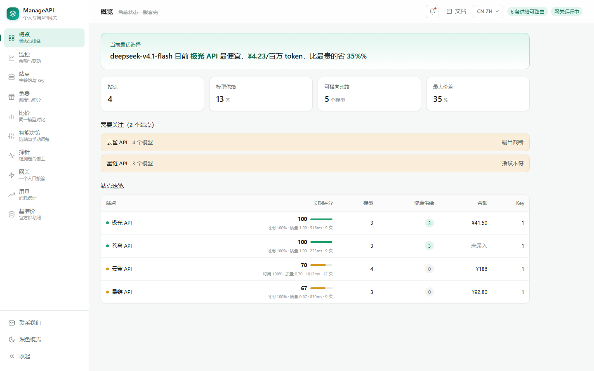

> 界面支持中英切换（顶栏右上角的下拉），选择记在浏览器里。
> 下图是英文模式：
>
> 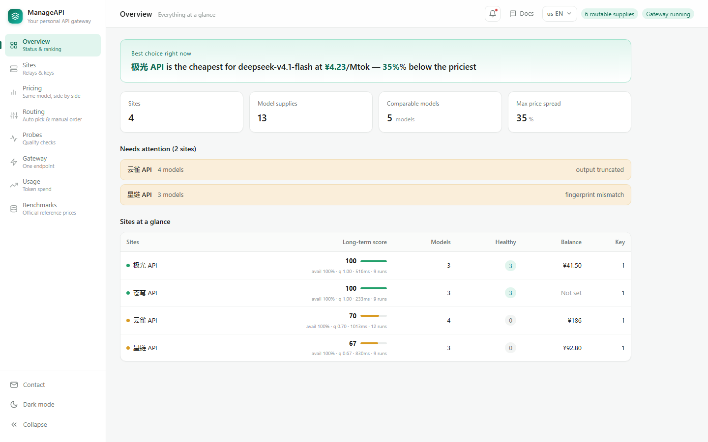

---

## 它解决什么问题

同时买了几个中转站的人都会遇到这三件事：

1. **算不清哪个划算。** 有的标 `$2.5/M`，有的标「0.4 倍」，有的按千 token 计，还有按次、按分组打折的。放到一张表里比，得先把计价口径统一。
2. **不知道有没有降智。** 站还活着，但悄悄把请求转给了便宜模型，或者压低 `max_tokens` 只吐一半。这类问题探活接口查不出来。
3. **切换很烦。** 每个客户端都要配一份 base_url 和 Key，哪家便宜就得挨个改。

ManageAPI 针对这三点，分别做了**比价**、**探针**、**网关**。

---

## 界面

左侧九页，每页一件事：

| 页面 | 用途 |
|---|---|
| **概览** | 一句话结论、关键指标、需要关注的站、各站速览 |
| **站点** | 录入站点与 Key，同步模型，导入分组倍率 |
| **免费** | 中转站免费模型与平台积分，独立成页、不参与付费比价 |
| **比价** | 同一模型跨站对比，行内改价 |
| **智能决策** | 路由候选排序，可手动上下调整 |
| **探针** | 指纹 / 截断 / 计费 / 缓存四项检测 |
| **网关** | 一个入口接管全部流量，含决策日志 |
| **用量** | 按天 / Key / 模型 / 站点统计 token |
| **基准价** | 倍率换算的参照表 |

顶栏右侧是通知、文档入口和语言下拉；侧边栏底部固定三个入口：联系我们、深色模式、收起。

支持深色模式（深蓝底 + 薄荷绿）：

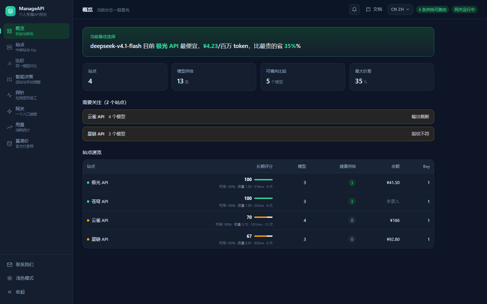

界面中英双语，顶栏下拉切换，偏好存在 `localStorage`。默认跟随浏览器语言（中文环境给中文，其余给英文）。

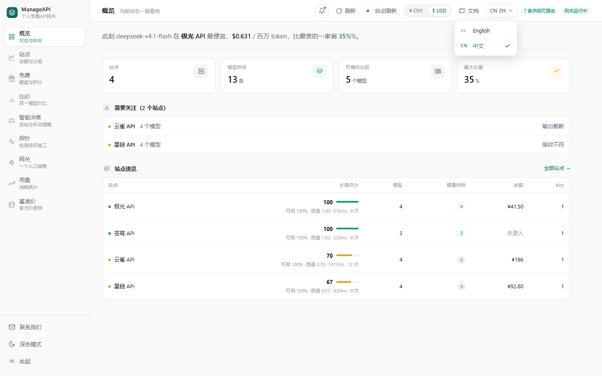

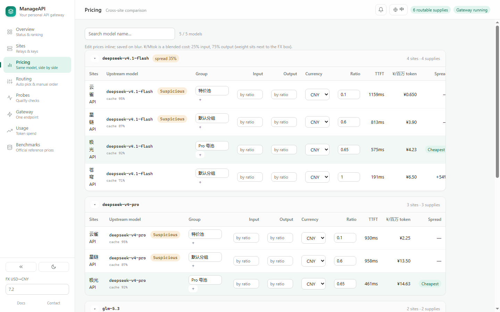

顶栏的「文档」打开内置使用说明，中英各一份，左边带目录：

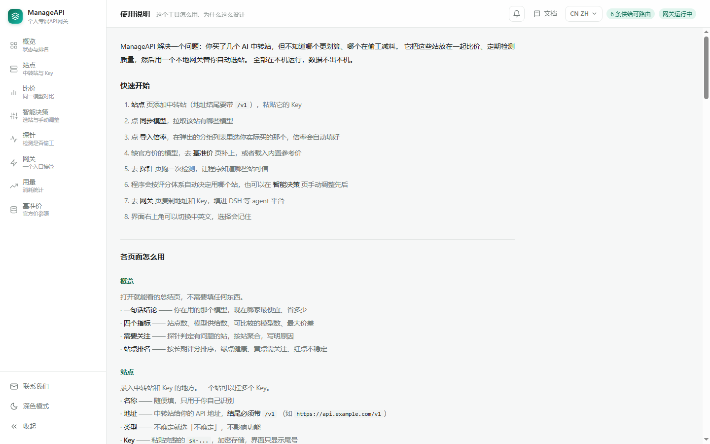

---

## 快速开始

需要 **Node.js ≥ 20**，没有其他依赖，不用 `npm install`。Windows / macOS / Linux 都能跑，代码里只有「打开浏览器」这一处区分平台。

```bash
git clone https://github.com/ZYH1207/ManageAPI.git
cd ManageAPI
node daemon/index.js
```

浏览器打开 <http://127.0.0.1:4319/>。

可选参数：

```bash
node daemon/index.js --port 5000   # 指定端口，被占用会自动往后找
node daemon/index.js --open        # 启动后自动开浏览器
```

首次启动会在 `~/.manage-api/` 生成数据目录和加密密钥。

### 五步上手

1. **站点**页添加中转站（地址结尾要带 `/v1`），粘贴它的 Key
2. 点 **同步模型**，拉取该站有哪些模型
3. 点 **导入倍率**，在弹出的分组列表里选你实际买的那一档，倍率自动填好
4. 缺官方价的模型，去 **基准价**页补上，或者载入内置参考价
5. 去 **探针**页跑一次检测，让程序知道哪些站可信

之后网关就会自动选站了；也可以在 **智能决策**页手动调整先后。

---

## 核心概念：分组 + 倍率

中转站的计费公式是：

```
实际价格 = 模型原价 × 分组倍率
```

倍率 `0.1` 就是打一折，`0.3` 是三折。

**「分组」就是你买的那一档套餐。** 一个站常常有十几个分组——特惠池、Pro 号池、企业通道、按次计费、某个模型专用的高价组。同一个模型在不同分组里，原价和倍率都可能不一样，**价格能差好几倍**。

所以「你在哪个分组」必须由你告诉工具：API 只能说明「这把 Key 能调用哪些模型」，不会说明「它属于哪一档套餐」——那是商务事实，不是技术信息。

### 导入倍率

站点卡片上点 **导入倍率**，会列出该站所有分组，每个后面标着倍率和能覆盖你几个模型，能用的排在前面：

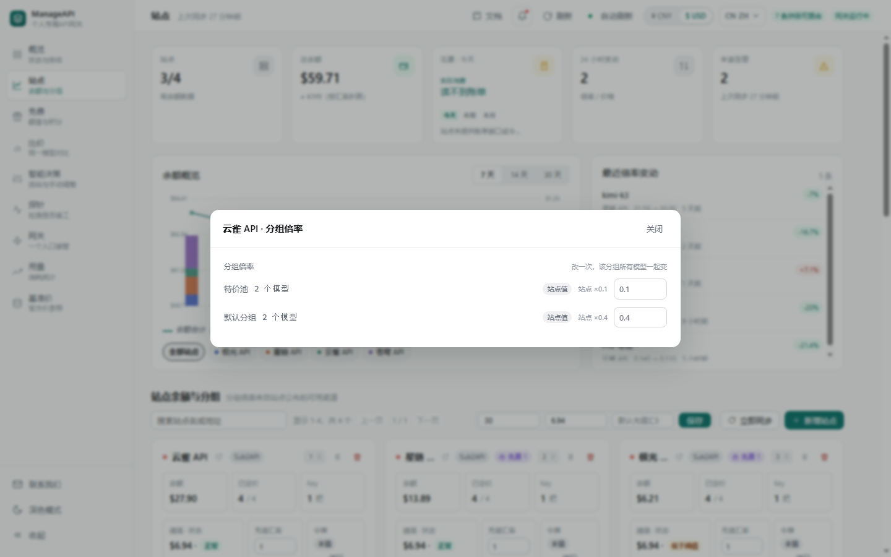

选中你买的那一档 → **应用倍率** → 倍率写进下面所有模型，比价 / 决策 / 路由立刻同步。选中的分组会记在这把 Key 上，下次打开默认选中。

数据来源：有「令牌」时读 `/api/v1/channels/available`（Sub2API 的可用渠道接口，数据最全，**不要求站点开启模型广场**）；没令牌则回落 `/api/v1/model-plaza`。

### 自定义倍率与恢复

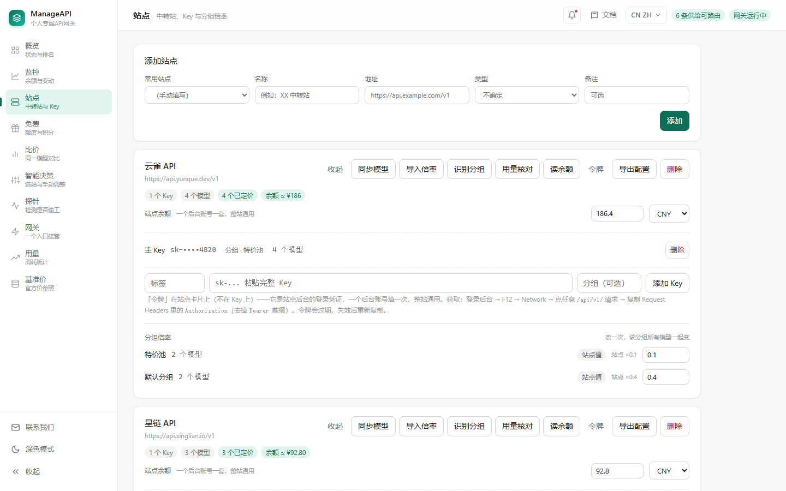

「分组倍率」那几行：

- 标 **站点值** —— 和站点公布的一致，没动过
- 标 **自定义** —— 你手改过，旁边会写出站点原本是多少
- 标 **混合** —— 这个分组下模型倍率不一致（单独改过某几个）
- 出现 **恢复** 按钮时点一下回到站点值；顶部 **全部恢复为站点值** 是整个站一起还原

改倍率有实际用处：比如站方标 0.15，但你用「用量核对」算出实际扣费相当于 0.18，就手动改成 0.18，比价结果才准。

### 基准价

倍率要换算成钱，得有个参照物。三个来源：

| 来源 | 说明 |
|---|---|
| **从站点导入官方价** | 拉取站方标注的模型原价，只补空缺不覆盖 |
| **以此站已填价为准** | 把你确信没虚标的那个站的实际价整体设为基准 |
| **载入内置参考价** | 内置一份各家官方价，冷启动用，**变动频繁务必核对** |

内置价只补空缺，来源列标 `reference:`，方便分辨。

这一页底部还有一个**汇率（USD→CNY）**输入框：只影响按美元标价的站点，人民币标价的站不受影响。放在这里是因为它本质是个价格换算参数，不需要天天看。

> 注：模型广场里另有一个 `official_pricing` 字段，实测不少站把它填成同一个占位值（比如所有 deepseek 模型都报 0.15），所以工具不用它，只用 `pricing`（站方原价）。

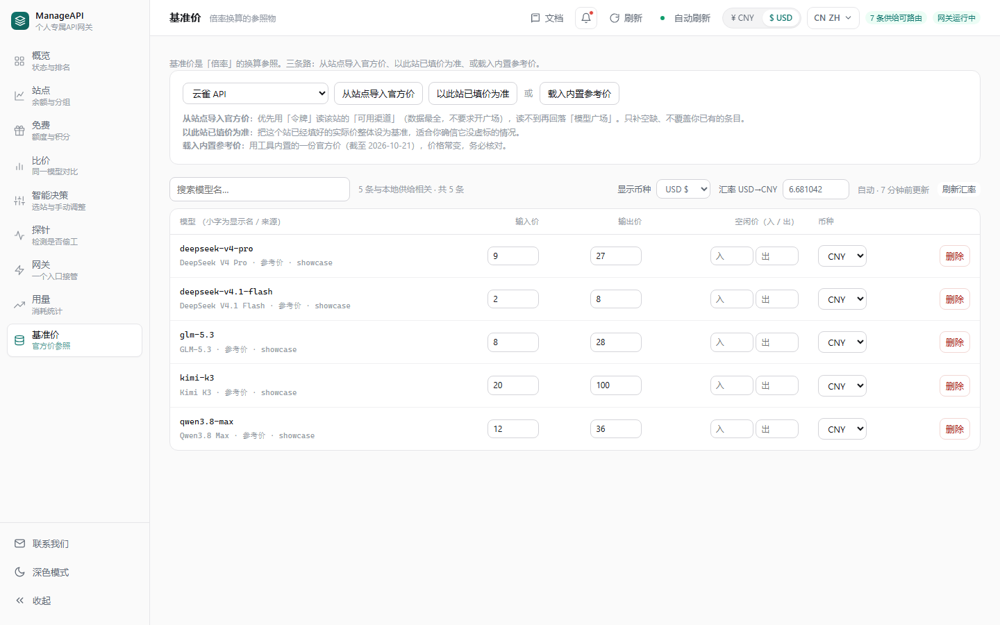

---

## 降智检测

中转站最常见的问题不是挂掉，是「还能用，但已经不是原来那个模型了」。

每个模型发 **5 个请求**，分别对应几种偷工方式：

| 偷工方式 | 检测手段 | 判定依据 |
|---|---|---|
| **掉包**：转给便宜模型 | 要求精确输出 `{"fp":"7Q2K","calc":391}` | 返回的 JSON 是否精确匹配 |
| **砍额度**：压低 `max_tokens` | 要求「数到 120」，同时请求 `max_tokens: 1500` | 最高数字 < 120，或 `finish_reason=length` 但 token 数远低于请求值 |
| **虚报**：用量远大于实际 | 对比 `usage.prompt_tokens` 与提示词实际规模 | 超过预期 3 倍即标记 |
| **缓存**：连发两次相同长前缀 | 看第二次的 `cached_tokens` | 只展示，不参与排序 |
| **身份自述** | 问它「你是什么模型」 | **只记录不评分**——模型自述本来就不可信，拿来扣分误伤太多 |

全部走流式请求，顺带拿到 TTFT（首 token 延迟）。

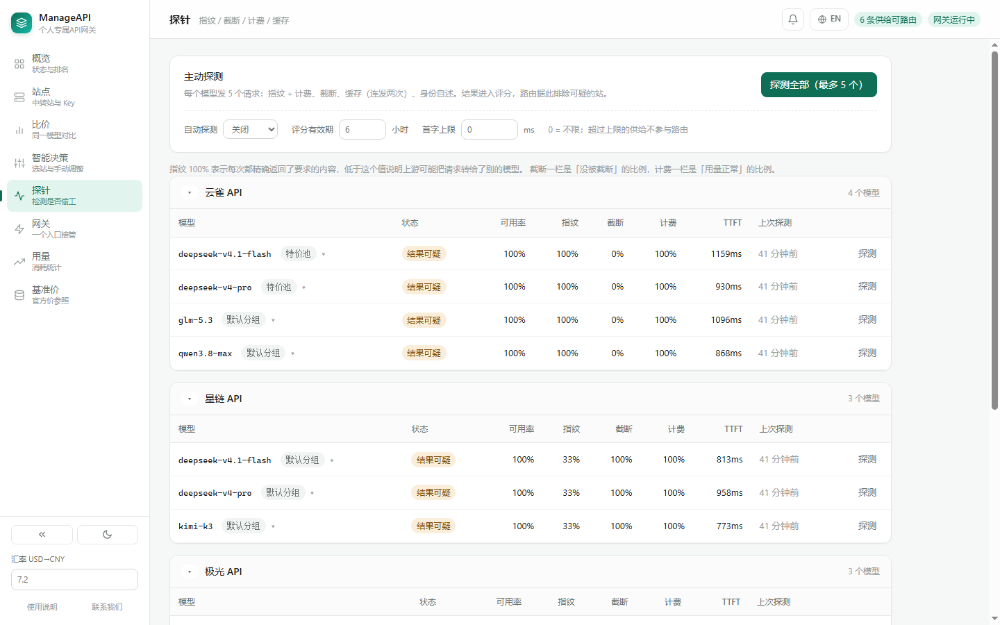

点表格里任意一行会展开，能看到分数怎么算出来的，以及最近一次探测的原始证据——掉包站会显示「实际返回 `{"fp":"XX99","calc":0}`」，砍额度站会显示「最高数字 41，finish_reason=length」。

### 评分怎么算

两个维度**分开算**，不揉成一个加权和：

```
可用率 availability = (探针成功 + 真实流量成功) / 全部样本
完整性 integrity    = 指纹通过率 × 0.5 + 未截断率 × 0.3 + 计费正常率 × 0.2
质量     quality    = availability × integrity
```

任一维度低于 0.8 就标记为不可用，默认排到最后只做兜底。

> **想让可疑的站也能用？** 探针页有个 **「放行可疑供给」** 开关。打开后，指纹不符 / 截断 / 虚报 / 评分过期的供给不再被压到后面，而是和健康的站一起按有效成本竞争——质量差一半成本就翻倍，所以只有便宜到足够多才会被选中。代价是它确实可能返回掉包或截断的结果，开关由你自己权衡。首字上限是独立设置，不受影响。

状态：

- `healthy` —— 两个维度都达标，可参与路由
- `degraded` —— 连得上但结果不可信（掉包 / 截断 / 虚报）
- `unstable` —— 连不上或频繁失败
- `stale` —— 评分超过有效期，需要重新探测
- `unknown` —— 还没探过，不参与路由

### 评分会过期

默认有效期 6 小时，可在探针页调整。过期后不再参与路由——**过期数据比没有数据更危险**，因为它会让你误以为已经检查过了。

这也是自动探测存在的理由：没有定时探测，评分迟早全部过期，路由退化成纯按价格选。

探针页可设自动探测间隔（默认 1 小时，可关）。调度器每分钟检查一次，挑出到期的供给（最多 10 个）去探。用「检查 + 到期判断」而不是长间隔定时器，改配置立即生效，一次探测耗时长也不会错过下一轮。

### 真实流量也算数

探针是模拟请求，测不出「高峰期 5xx」。所以网关每次转发的成败也会累计到对应供给上，和探针一起算可用率。

实测：一个站探针正常，连续 3 次真实请求失败后可用率从 100% 掉到 63%，状态变 `unstable`，下次路由就跳过它。流量计数按 1 小时窗口滚动——上午挂了下午恢复的站，不该被上午的失败一直拖累。

---

## 有效成本：为什么用除法

```
有效成本 = 名义价格 ÷ 质量
```

直观含义是「为一份可信输出实际付了多少钱」。

为什么不用加权求和？因为「便宜 10% 但降智 30%」的站，加权后可能仍然胜出；而除以质量之后，质量掉一半成本就翻倍，再怎么便宜也压不住。这个公式还天然可解释。

决策页就是这么排的——名义价 ¥0.65 的站被 ¥4.23 的站顶掉，因为它被判「结果可疑」：

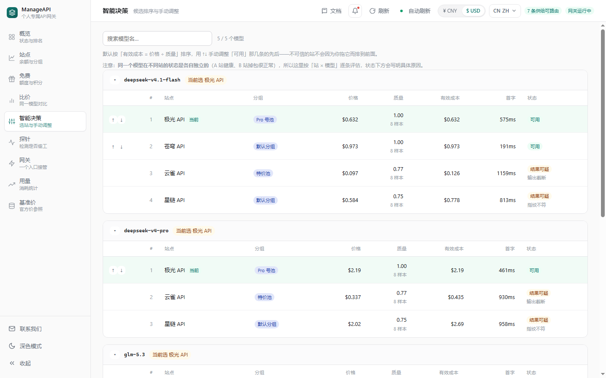

### 手动干预

纯自动有个问题：**你没法表达「我就想用这家」**。所以每行前面有 ↑↓，可以调整顺序。

手动顺序只作用于「可用」的那几条：

- 不可信 / 太慢 / 过期的供给默认排在后面，拖不动它——**可用性是硬判断，不能被手动覆盖**（想让它们参与竞争，去探针页打开「放行可疑供给」）
- 新出现的供给如果不在手动顺序里，按自动排序追加在后面
- 点「恢复自动」清掉手动顺序

### 首字延迟

延迟**不参与**有效成本排序——它和价格量纲不同，加权会失真。取而代之的是一个可选上限：探针页设「首字上限」，超过的供给不参与路由，比价表里标「超时」，同时取消它的「最便宜」标记。

想省钱就让慢站参与，赶时间就设个上限，规则简单可预期。

### 缓存命中只展示、不折算

中转站普遍对缓存命中的输入 token 打 1-2 折。检测方法是同一段 1200+ token 的前缀连发两次，只看第二次的 `cached_tokens`（中间留 1.5 秒让上游写缓存）。

**这一项不参与排序。** 缓存收益取决于你的使用模式——请求前缀都不重复的话命中率就是 0，那个「便宜」对你没意义。用标价排序保证最坏情况下的成本，缓存算额外红利。

---

## 免费额度：另一个池子

中转站的免费模型和 Agent 平台的免费积分，收在一个独立页面里，**不参与付费比价，也不参与自动选站**。

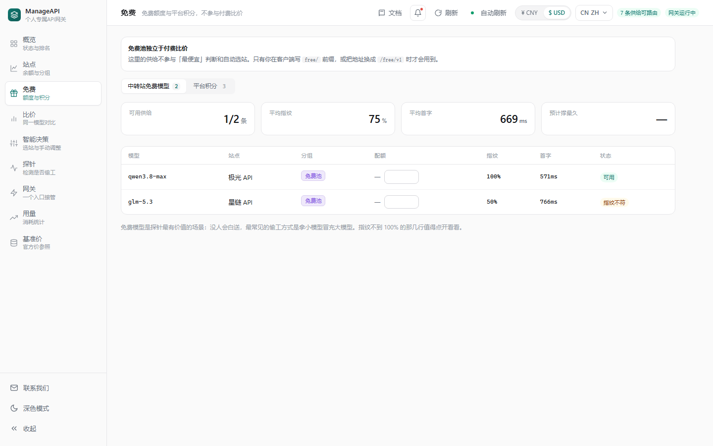

页内用顶部切换分两栏：

| 栏 | 看什么 | 闸门 |
|---|---|---|
| **中转站免费模型** | 实际价为 0 的模型，含配额进度条 | 指纹 / 未截断 / 额度耗尽 / 评分过期 |
| **平台积分** | WorkBuddy、Trae 等平台的账号与剩余积分 | 额度耗尽 / 会话失效 |

**为什么必须分开**：付费侧能混排，是因为所有供给有共同的可比指标——有效成本。免费侧价格恒为 0，`0 ÷ 质量` 永远是 0，加权排序会直接失效。所以免费侧用「**闸门 + 单指标排序**」：质量不达标就整个排除，不给「便宜但烂」留位置。

**怎么用**：

```bash
# 整个客户端只用免费
base_url = http://127.0.0.1:4319/free/v1

# 或者混着用，模型名前缀区分
model = deepseek-v4.1-flash        # 付费池
model = free/deepseek-v4.1-flash   # 免费池
```

前缀只能把请求「升级」到免费池，不能降级回付费，所以两种入口不会冲突。免费池用尽时返回 `402 free_pool_exhausted` 并列出各来源的重置时间，**不会静默回落到付费**——那等于背着你花钱。

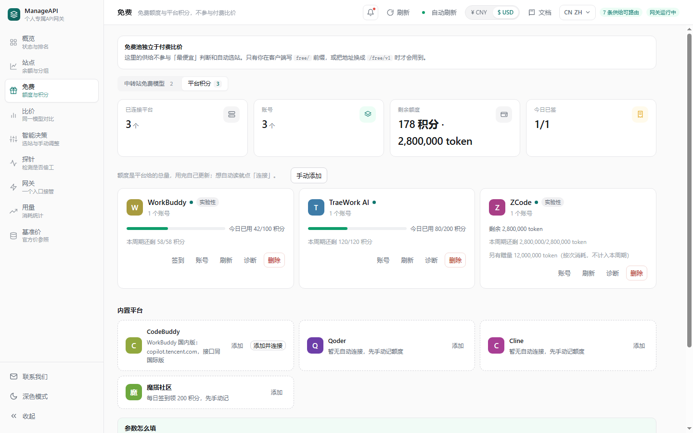

平台侧支持多账号、每日签到（幂等，同一天只成功一次）和额度倒计时。WorkBuddy / CodeBuddy 支持点「连接」后自动读积分，标了**实验性**——它走的是平台给自家 IDE 用的未公开接口，平台升级可能失效；失效时只是读不到数据，不影响别的功能。

站点页和平台页都内置了一份**常用目录**（硅基流动、魔搭、DeepSeek、Moonshot、智谱、百炼、火山方舟、OpenAI…），选中就自动填好名称和地址，只差一个 Key。拿不准地址的（AgentRouter、AnyRouter、PPIO）留空让人自己补，不猜。

---

## 网关：一个 Key 用全部站点

客户端里这样填：

| 项 | 值 |
|---|---|
| Base URL | `http://127.0.0.1:4319/v1` |
| API Key | 「网关」页显示的 `sk-mapi-...` |

然后照常请求，`model` 填归一化后的名字（`GET /v1/models` 能列出来）。换上游 Key 时客户端不用改。

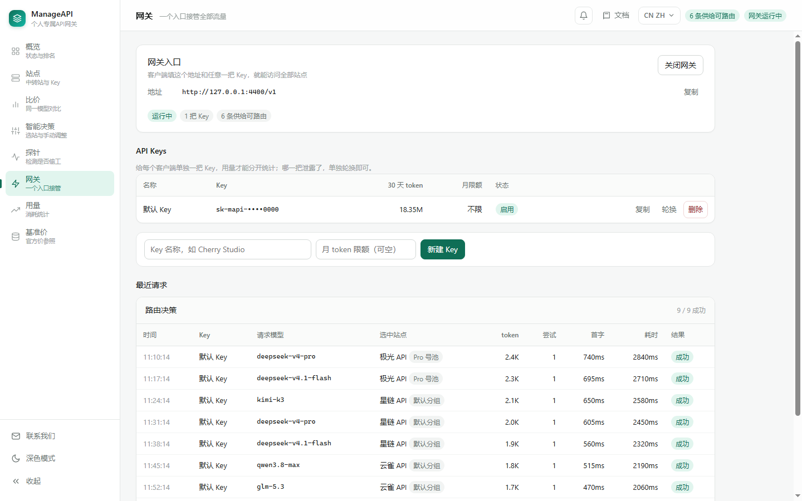

### 怎么选站

```
1. 排除探针判定不可信的（unstable / degraded）、超过首字上限的、评分过期的
2. 剩下的按「有效成本 = 价格 ÷ 质量」升序
3. 第一个失败，在响应给客户端之前自动换下一个
```

流式的关键边界：**必须读到第一个 chunk 并确认它不是错误，才向客户端提交响应头**。在这之前失败都能静默换站；一旦提交，就只能收尾，不能再重试。所以顺序很重要——第一个站要选最可能成功的。

### 响应头

| 头 | 含义 |
|---|---|
| `X-ManageAPI-Provider` | 实际服务的站点（URL 编码） |
| `X-ManageAPI-Attempts` | 尝试了几次 |
| `X-ManageAPI-Quality` | 该供给的质量分 |

「网关」页有决策日志：每次请求选了谁、候选怎么排的、失败原因是什么。

### 多把 Key

每个客户端单独建一把，用量才能归因；哪一把泄露了单独轮换，不影响其他客户端。每把 Key 可以设月度 token 上限，超了返回 429。

### usage 是怎么拿到的

客户端通常不会传 `stream_options.include_usage`，上游也就不返回用量。网关的做法是**自动注入**这个参数，然后把那个「只含 usage、choices 为空」的收尾 chunk **过滤掉**再转发。客户端收到的流和原来完全一样，但网关拿到了准确数据。

代价是流式转发要按 SSE event 切分处理，而不是整块透传。

---

## 用量

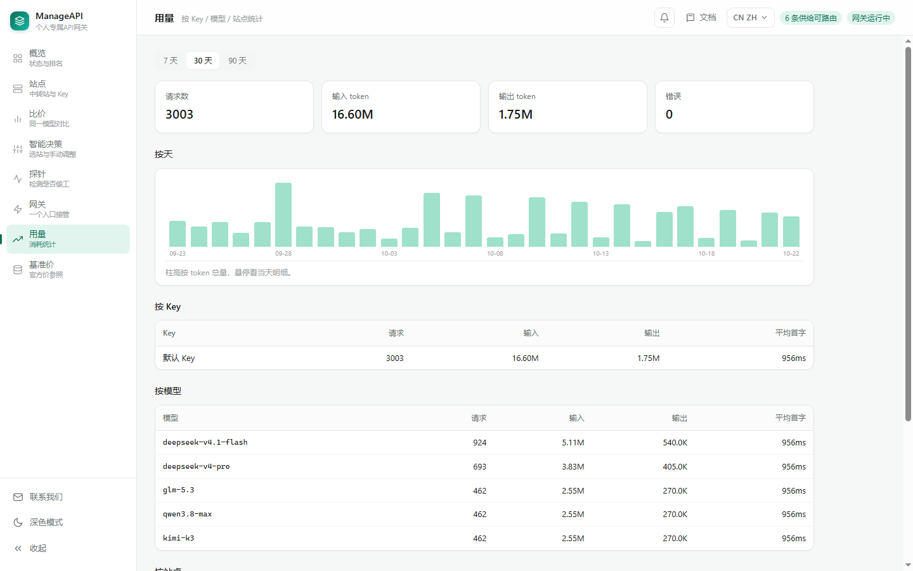

按「天 × Key × 站点 × 模型」聚合，独立存 `usage.json`——它是唯一会持续增长的数据，混进配置文件会让每次写配置都变慢。

记录请求数、错误数、输入/输出 token、缓存命中、平均延迟、平均首字延迟。四个切面：按天柱图、按 Key、按模型、按站点，可切 7 / 30 / 90 天。

**只有经过网关的请求才计入。** 直接在站上用的、别的客户端没走网关的，都不算。

---

## 数据与安全

所有数据都在 `~/.manage-api/`：

| 文件 | 内容 |
|---|---|
| `db.json` | 站点、凭据（密文）、模型供给、价格、探针记录 |
| `master.key` | AES-256-GCM 密钥，首次启动自动生成，权限 0600 |
| `benchmark.json` | 基准价表，可手工编辑 |
| `usage.json` | 用量统计（按天聚合，会持续增长） |

可以用环境变量换目录：`MANAGE_API_HOME=/path/to/data node daemon/index.js`

**威胁模型说明**：Key 加密防的是「备份泄露、误传文件、误提交仓库」，不防「本机已被攻破」——因为密钥就在同一个目录下。要更高强度需要改成主密码派生（启动时输入一次），当前版本没做。

daemon 只绑 `127.0.0.1`，不对外网开放，也不做鉴权。**不要改成 `0.0.0.0`。**

---

## 已知限制

- **余额多半读不到。** one-api 的 `/api/user/self` 要「用户访问令牌」而不是 `sk-` key；不少站直接关了这类接口；Sub2API 的账户接口在 `/api/v1/*` 下、只认登录态。解决办法：在站点卡片上点「令牌」，把浏览器里抓到的登录令牌填进去（一个后台账号填一次，整站通用）。读不到就手动填，工具不会猜一个数字。
- **只代理 `/v1/chat/completions` 和 `/v1/models`**。embeddings、images 等没做。
- **用量依赖上游返回 `usage`。** 少数站即使要求了也不返回，这类请求记 0 token，但请求数仍计入。
- **价格单位只支持「每百万 token」和「每千 token」**，不支持按次计费。
- **同一时间只能跑一个实例。** 多个进程会抢同一个数据目录互相覆盖。

---

## 目录结构

```
core/              宿主无关的核心逻辑（不依赖任何运行时框架）
  store.js           数据目录、JSON 原子写、凭据加解密
  inventory.js       站点 / 凭据 / 模型供给 CRUD、分组倍率、网关 Key、路由日志
  pricing.js         成本归一、排序、结论生成
  benchmark.js       基准价表
  model-prices.js    内置官方参考价
  providers.js       出站请求：拉模型、试读余额、读可用渠道 / 模型广场
  model-plaza.js     模型广场解析（分组倍率 + 模型原价）
  probe.js           指纹 / 截断 / 虚报 / 缓存 四项探测
  score.js           短期评分（含有效期）、长期评分（时间衰减）
  router.js          候选筛选与排序
  usage.js           用量聚合（天 × Key × 站点 × 模型）
  free.js            免费池判定：实际价 = 0、free/ 前缀、入口解析
  quota.js           免费额度记账（按次 / token / 积分，日 / 月窗口）
  rank-free.js       免费池闸门与排序（质量只做闸门，不参与排序）
  platforms/         平台积分：connector 接口、手动连接器、额度账本、独立 free.json
  catalog.js         常用站点 / 平台预置目录（只填能确认的地址）
  balance.js         云厂商余额适配器（硅基流动 / DeepSeek / Moonshot）

daemon/            本地 HTTP 服务 + 网关（同一个端口）
  index.js           启动、端口选择、开浏览器
  server.js          HTTP 路由、网关转发、SSE 切分
  probe-runner.js    探测执行器（手动与定时共用）
  scheduler.js       定时探测调度

web/               前端（原生 JS，无构建，无框架）
  index.html         结构与使用说明正文（中英各一份）
  app.js             全部渲染与交互
  i18n.js            语言切换与英文词典
  free-relay.js      免费页 · 中转站栏
  free-platform.js   免费页 · 平台栏
  style.css          CSS 变量双主题

.test/             测试与截图工具
  mock-upstream.mjs  假中转站（MODE=good|degraded|truncated|fail）
  run-*.mjs          端到端脚本
  seed-showcase.mjs  生成 README 用的展示数据
  capture-shots.mjs  无头 Chrome 抓截图（SHOT_LANG=en 出英文图）
  check-lang.mjs     中英切换往返检查
  check-free-relay.mjs   免费池闸门与配额记账自检
  check-free-platform.mjs 平台侧 CRUD / 签到幂等 / 账本自检
  dump-strings.mjs   把界面上所有中文文案抓成清单，加新文案时对照用

docs/              README 用图 + 设计文档
  dsh-plugin-plan.md DSH 插件端规划（功能清单与扩展点）
  free-api-plan.md   免费额度池开发计划（中转站免费模型 + 平台积分）
```

`core/` 不依赖任何宿主，可以单独复用。

---

## 开发

没有构建步骤，改完文件刷新浏览器即可。`daemon/index.js` 不带文件监听，改后端要重启进程。

### 跑测试

```bash
# 终端 1：起一个「好站」
MODE=good PORT=5101 node .test/mock-upstream.mjs

# 终端 2：指向它跑端到端
node .test/run-e2e.mjs
```

`MODE` 可选 `good` / `degraded`（掉包 + 虚报）/ `truncated`（砍额度）/ `fail`（连不上）。

### 检查中英切换

改完界面文案后，跑一次这个，确认切到英文再切回来没有残留：

```bash
chrome --headless=new --remote-debugging-port=9222 about:blank &
node .test/check-lang.mjs
```

### 重新生成 README 截图

```bash
MANAGE_API_HOME=/tmp/showcase node .test/seed-showcase.mjs
MANAGE_API_HOME=/tmp/showcase node daemon/index.js --port 4319

# 另一个终端
chrome --headless=new --remote-debugging-port=9222 about:blank
node .test/capture-shots.mjs
```

展示数据里的站点名（云雀 / 星链 / 极光 / 苍穹）全是虚构的。

---

## 路线图

- **更多上游类型** —— 目前针对 one-api / new-api / Sub2API 系优化，其他自建网关要手动填价
- **按次计费** —— 现在只支持按 token 计价
- **主密码派生密钥** —— 提升本地密钥强度
- **免费额度池** —— 收集中转站的免费模型与 Agent 平台的免费积分，独立成页、独立排序，不参与付费比价。方案见 [`docs/free-api-plan.md`](docs/free-api-plan.md)
- **DSH 插件形态** —— 不只是搬进侧边栏：注册成 DSH 的 provider，让 agent 的每次真实对话都参与选站并回写评分。方案见 [`docs/dsh-plugin-plan.md`](docs/dsh-plugin-plan.md)

---

## 反馈

- 提 Issue：<https://github.com/ZYH1207/ManageAPI/issues>
- 邮箱：<2385377554@qq.com>
- 博客：<https://zyh1207.github.io/>

## License

[MIT](LICENSE)
