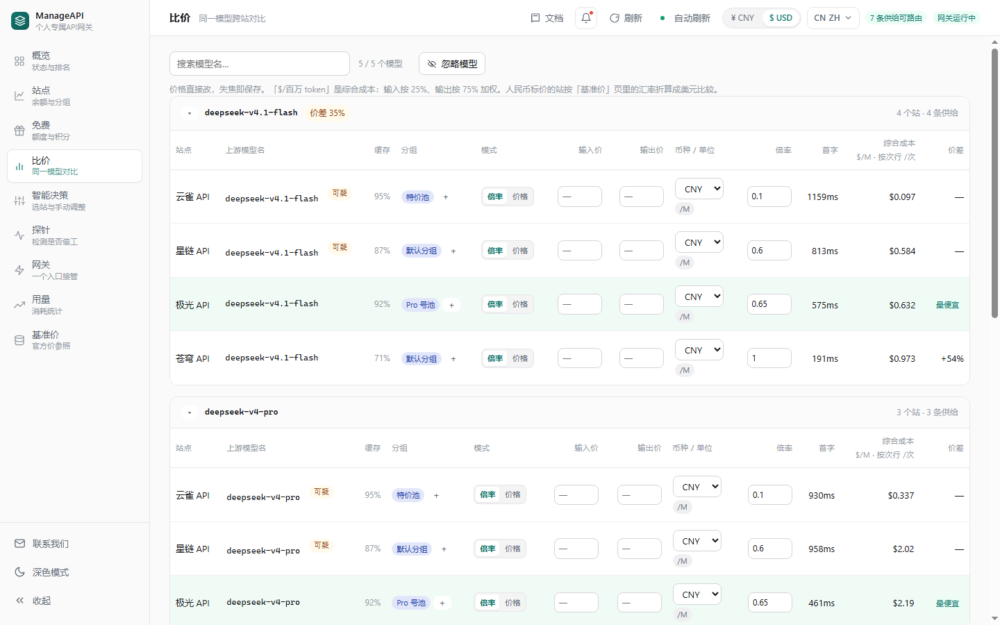

# ManageAPI

**管好你买的多个 AI 中转站：算清哪家最便宜、盯住哪家在偷工、用一个 Key 走全部站点。**

零依赖、零构建、纯本地。一个 Node 进程 + 一个网页，数据不出本机。

**中文** · [English](README.en.md)


---

## 它解决什么问题

同时买了几个中转站的人都会撞上这三件事：

1. **算不清哪个划算。** 有的标 `$2.5/M`，有的标「0.4 倍」，有的按千 token，还有按次、按分组打折的。得先把计价口径统一才能比。
2. **不知道有没有降智。** 站还活着，但悄悄换成便宜模型，或者压低 `max_tokens` 只吐一半。探活接口查不出来。
3. **切换很烦。** 每个客户端都要配一份 base_url 和 Key，哪家便宜就挨个改。

ManageAPI 针对这三点分别做了 **比价**、**探针**、**网关**。

## 快速开始

需要 **Node.js ≥ 20**，没有依赖，不用 `npm install`。

```bash
git clone https://github.com/ZYH1207/ManageAPI.git
cd ManageAPI
node daemon/index.js
```

打开 <http://127.0.0.1:4319/>。首次启动会在 `~/.manage-api/` 生成数据目录和加密密钥。

```bash
node daemon/index.js --port 5000   # 指定端口（被占用会自动往后找）
node daemon/index.js --open        # 启动后自动开浏览器
```

**五步上手**

1. **站点**页添加中转站（地址结尾带 `/v1`），粘贴它的 Key
2. 点 **一键同步**：拉模型、读余额、识别分组一次跑完
3. 没认出分组就点 **导入倍率**，选你实际买的那一档
4. 缺官方价的模型去 **基准价**页补上，或载入内置参考价
5. 去 **探针**页跑一次检测，让程序知道哪些站可信

之后网关就会自动选站，也可以在 **智能决策**页手动调序。

---

## 界面

左侧九页，每页一件事。

| 页面 | 用途 |
|---|---|
| **概览** | 一句话结论、关键指标、需要关注的站、各站速览 |
| **站点** | 余额曲线、倍率变动、上游公告；站点与 Key 管理（版式参考 [bejix/upstream-ops](https://github.com/bejix/upstream-ops)） |
| **免费** | 中转站免费模型与平台积分，独立成页、不参与付费比价 |
| **比价** | 同一模型跨站对比，行内改价 |
| **智能决策** | 路由候选排序，可手动上下调整 |
| **探针** | 指纹 / 截断 / 计费 / 缓存四项检测 |
| **网关** | 一个入口接管全部流量，含决策日志 |
| **用量** | 按天 / Key / 模型 / 站点统计 token |
| **基准价** | 倍率换算的参照表 |



深色模式、中英双语（默认跟随浏览器语言，偏好存 `localStorage`）：


顶栏「文档」打开内置使用说明，中英各一份、带目录。完整英文界面见 [`screenshot-overview-en.png`](docs/screenshot-overview-en.png)。

---

## 核心概念：分组 + 倍率

中转站的计费公式是 `实际价格 = 模型原价 × 分组倍率`。倍率 `0.1` 就是打一折。

**「分组」就是你买的那一档套餐。** 一个站常有十几个分组——特惠池、Pro 号池、企业通道、按次计费。同一个模型在不同分组里原价和倍率都可能不同，**价格能差好几倍**。

「你在哪个分组」必须由你告诉工具：API 只能说「这把 Key 能调哪些模型」，不会说「它属于哪一档套餐」——那是商务事实，不是技术信息。

站点卡片点 **导入倍率**，会列出所有分组、倍率和覆盖模型数：


> 分组胶囊按**厂商品牌色**着色：国产统一蓝，OpenAI 绿、Claude 橙、Gemini 黄，**免费分组紫**（跨页面认「免费」）；混合厂商或识别不出的保持中性灰、不猜。胶囊内倍率数字与分组文字同色仅加粗，只有**加价档位**才示警：>1.2 橙、>2 红。

数据来源：有「令牌」时读 `/api/v1/channels/available`（数据最全，**不要求站点开启模型广场**）；没令牌回落 `/api/v1/model-plaza`。

**比价表每条供给可二选一：倍率 或 价格。** 倍率模式 = 基准价 × 倍率（单价框禁用）；价格模式 = 直接填输入/输出单价（倍率框禁用）。从倍率切到价格时会把当前折算价写进单价框，不会变成「未定价」从表里消失。


倍率状态有三种：**站点值**（没动过）、**自定义**（你手改过，旁边写出站点原值）、**混合**（该分组下个别模型单独改过）。出现「恢复」按钮时点一下回到站点值。

---

## 降智检测

中转站最常见的问题不是挂掉，是「还能用，但已经不是原来那个模型了」。

每个模型发 **5 个请求**，各对应一种偷工方式：

| 偷工方式 | 检测手段 | 判定 |
|---|---|---|
| **掉包**：转给便宜模型 | 要求精确输出 `{"fp":"7Q2K","calc":391}` | JSON 是否精确匹配 |
| **砍额度**：压低 `max_tokens` | 要求「数到 120」，同时请求 `max_tokens: 1500` | 最高数字 < 120，或 `finish_reason=length` 却 token 数远低于请求 |
| **虚报**：用量远大于实际 | 对比 `usage.prompt_tokens` 与提示词实际规模 | 超过预期 3 倍即标记 |
| **缓存**：连发两次相同长前缀 | 看第二次的 `cached_tokens` | 只展示，不参与排序 |
| **身份自述** | 问它「你是什么模型」 | **只记录不评分**——自述本来就不可信 |

全部走流式请求，顺带拿到 TTFT。


点任意一行展开，能看到分数怎么算出来、以及原始证据（掉包站会显示实际返回的 JSON）。

### 评分

两个维度**分开算**，不揉成一个加权和：

```
可用率 availability = (探针成功 + 真实流量成功) / (成功 + 真正的故障)
完整性 integrity    = 指纹通过率 × 0.5 + 未截断率 × 0.3 + 计费正常率 × 0.2
质量     quality    = availability × integrity
```

**失败要先归因，再决定算不算账**：5xx / 超时 / 连不上算故障；余额不足、限流、模型不在分组**不算**，改成冷却（30 / 5 / 60 分钟）——这些不是站不稳，而是这条供给此刻拿不到，算成故障会让一堆只是没额度的站长期挂红，真故障反而被淹掉。

任一维度低于 0.8 标记为不可用，默认排到最后只做兜底。

**完整性只看原始证据，不看平均分**：指纹不符单次即判（掉包是确定性的）；截断/虚报要 2 个样本；真实响应的空回答/计费虚报要 5 个样本、异常率 >20%。显示用的通过率按 `(通过+1)/(样本+1)` 平滑——**惩罚力度必须和证据强度匹配**。

> 探针页有 **「放行可疑供给」** 开关：打开后可疑供给不再被压到后面，而是按有效成本正常竞争（质量差一半成本就翻倍）。代价是它确实可能返回掉包结果，由你权衡。

状态：`healthy` 可路由 / `degraded` 结果不可信 / `unstable` 真故障率 >20% / `inconclusive` 证据不足 / `stale` 评分过期 / `unknown` 没探过。

**评分会过期**（默认 6 小时）——过期数据比没有数据更危险，会让你误以为检查过了。「过期」看的是最后一次有效证据（探针或真实调用，取最近的），不是最后一次探针。

自动探测默认 1 小时一轮，且是**自适应**的：健康的站按设定间隔，其它站按 1/3 间隔补测（最少 10 分钟）。探针和采集都靠这个。

---

## 有效成本：为什么用除法

```
有效成本 = 名义价格 ÷ 质量
```

直观含义是「为一份可信输出实际付了多少钱」。不用加权求和，是因为「便宜 10% 但降智 30%」的站加权后可能仍然胜出；除以质量后，质量掉一半成本就翻倍，再便宜也压不住。


每行前面有 ↑↓ 可手动调序，但**可用性是硬判断、不能被手动覆盖**——不可信/太慢/过期的供给拖不动（想让它们参与竞争就开「放行可疑供给」）。

首字延迟**不参与**有效成本排序（量纲不同，加权会失真），改成一个可选上限：超过的供给不参与路由、比价表标「超时」。

缓存命中率**只展示不折算**：收益取决于你的使用模式，请求前缀都不重复时命中率就是 0。用标价排序保证最坏情况成本，缓存算额外红利。

---

## 免费额度：另一个池子

中转站的免费模型和 Agent 平台的免费积分收在独立页面，**不参与付费比价，也不参与自动选站**。


| 栏 | 看什么 | 闸门 |
|---|---|---|
| **中转站免费模型** | 实际价为 0 的模型，含配额进度条 | 指纹 / 未截断 / 额度耗尽 / 评分过期 |
| **平台积分** | WorkBuddy / CodeBuddy / ZCode 等平台的账号与剩余积分 | 额度耗尽 / 会话失效 |

**为什么必须分开**：付费侧能混排是因为有共同可比指标——有效成本；免费侧价格恒为 0，`0 ÷ 质量` 永远是 0，加权排序直接失效。所以免费侧用「闸门 + 单指标排序」：质量不达标整个排除，不给「便宜但烂」留位置。

```bash
base_url = http://127.0.0.1:4319/free/v1      # 整个客户端只用免费

model = deepseek-v4.1-flash                   # 付费池（同一个入口混着用）
model = free/deepseek-v4.1-flash              # 免费池
```

前缀只能把请求**升级**到免费池，不能降级回付费。免费池用尽时返回 `402 free_pool_exhausted` 并列出各来源重置时间，**不会静默回落到付费**——那等于背着你花钱。


平台侧支持多账号、每日签到（幂等）和额度倒计时。**只有实现了自动签到的平台才显示「签到」按钮**，省得点了报错。WorkBuddy / CodeBuddy 支持点「连接」自动读积分，标了**实验性**——走的是平台给自家 IDE 用的未公开接口，平台升级可能失效，失效时只是读不到数据。

ZCode（智谱）走另一条路：它的授权是桌面协议 `zcode://…`，所以不模拟登录，而是**直接读本机 ZCode 客户端的登录态**拿 JWT 再调套餐接口。真凭据始终留在客户端。额度分「本周期」和「一次性赠量」两种口径，卡片分别写清楚。

---

## 网关：一个 Key 用全部站点

客户端里这样填：

| 项 | 值 |
|---|---|
| Base URL | `http://127.0.0.1:4319/v1` |
| API Key | 「网关」页显示的 `sk-mapi-...` |

`model` 填归一化后的名字（`GET /v1/models` 能列出来）。换上游 Key 时客户端不用改。


**选站顺序**：排除不可信 / 超过首字上限 / 评分过期的 → 剩下按「有效成本」升序 → 第一个失败就在响应给客户端**之前**自动换下一个。

流式的关键边界：**必须读到第一个 chunk 并确认它不是错误，才向客户端提交响应头**。在这之前失败都能静默换站；一旦提交就只能收尾。

响应头带 `X-ManageAPI-Provider` / `X-ManageAPI-Attempts` / `X-ManageAPI-Quality`。网关页有决策日志：每次请求选了谁、候选怎么排的、失败原因。

**usage 怎么拿到**：客户端通常不传 `stream_options.include_usage`，网关**自动注入**这个参数，然后把那个「只含 usage、choices 为空」的收尾 chunk **过滤掉**再转发。客户端收到的流完全一样，但网关拿到了准确数据。

每个客户端建议单独建一把 Key，用量才能归因；可设月度 token 上限，超了返回 429。

---

## 用量


按「天 × Key × 站点 × 模型」聚合，独立存 `usage.json`（唯一会持续增长的数据，混进配置文件会让每次写配置都变慢）。四个切面：按天柱图、按 Key、按模型、按站点，可切 7 / 30 / 90 天。

**只有经过网关的请求才计入。**

---

## 监控

比价和探针回答「现在哪家划算」，监控回答「这几天发生了什么」。

默认每 30 分钟采一轮（可关）。采集只读站点接口、不花 token，所以能比探针勤：

- **余额** —— 走站点后台接口，需要先填「令牌」。读不到就显示「无数据」，不猜数字。
- **实际消费** —— **直接读站点自己的账单**（`/api/v1/usage` 逐条 `actual_cost` 汇总）。为什么不用网关估算：实测上游约 **26% 的 token 没进账**（不返回 `usage` 的请求只能记 0），且 `cached_tokens` 不稳定（同一站同一天有时报 553216、有时报 128），叠加后能把估算和真实账单差出 7~10 倍。读不到账单显示「读不到账单」而不是 0。
- **分组倍率** —— 来自 `/api/v1/channels/available`，顺手把模型原价一起读回。
- **上游公告** —— `/api/status` 和 `/api/v1/announcements`，按标题+发布时间去重。

**告警按「站点 × 类型」冷却**，同样的余额过低六小时内只记一条。第一次采集只记基线、不发变动——否则一接入就是满屏「新出现」。

---

## 数据与安全

所有数据都在 `~/.manage-api/`：

| 文件 | 内容 |
|---|---|
| `db.json` | 站点、凭据（密文）、模型供给、价格、探针记录、监控历史 |
| `master.key` | AES-256-GCM 密钥，首次启动自动生成，权限 0600 |
| `benchmark.json` | 基准价表，可手工编辑 |
| `free.json` | 免费池平台账号与积分账本 |
| `usage.json` | 用量统计（按天聚合，会持续增长） |

`MANAGE_API_HOME=/path/to/data node daemon/index.js` 可换目录。

**自动备份**：启动时和之后每 24 小时把数据复制到同级的 `manage-api-backups/`，每份一个时间戳目录，默认保留最近 30 份（`MANAGE_API_BACKUP_KEEP` 可改）。**恢复时必须 `db.json` 和 `master.key` 配对**，只恢复 db 会导致所有 Key 解不开。备份里有 `master.key`，和原数据一样敏感：不要提交仓库、不要放公共网盘。

**单实例**：数据目录下的 `daemon.lock` 记录 PID + 端口，第二个实例会直接退出。

**访问控制**：只监听 `127.0.0.1`，并校验 `Host` 头只接受 `127.0.0.1` / `localhost` / `[::1]`——防的是 DNS rebinding。写接口还要求 `Content-Type: application/json`。所以**不要用反向代理暴露到公网**，Host 校验会直接返回 403，这是有意的。

**威胁模型**：Key 加密防的是「备份泄露、误传文件、误提交仓库」，不防「本机已被攻破」——密钥就在同一目录下。

---

## 已知限制

- **余额多半读不到。** one-api 的 `/api/user/self` 要「用户访问令牌」而不是 `sk-` key；不少站关了这类接口。解决办法：在站点卡片填「令牌」（浏览器里抓到的登录令牌，一个后台账号填一次）。读不到就手动填，工具不猜数字。
- **只代理 `/v1/chat/completions` 和 `/v1/models`**，embeddings / images 没做。
- **用量依赖上游返回 `usage`。** 少数站即使要求了也不返回，这类请求记 0 token，但请求数仍计入。
- **按次计费的供给不参与「最便宜」比价**（量纲不同）。计费形式由模型广场的 `billing_mode` 自动识别；站点没开广场时可手动把单位改成 `/次`。
- **同一时间只能跑一个实例。**

---

## 开发

没有构建步骤，改前端刷新浏览器即可；改后端要重启进程。

```bash
node .test/run-monitor.mjs     # 自包含：自起假上游、自起服务、跑完退出
node .test/check-fx.mjs        # 汇率：自动/手动/失败兜底（假 fetch，不联网）
node .test/run-e2e.mjs         # 端到端探针（需先起 3 个假站 + 4399 实例，见文件头注释）
node .test/run-gateway.mjs     # 网关：路由、故障切换、流式、鉴权
```

`core/` 不依赖任何宿主，可以单独复用。目录结构与测试脚本清单见 [`docs/`](docs/)，或直接读 `package.json` 的 `scripts`。

重新生成 README 截图：

```bash
MANAGE_API_HOME=/tmp/showcase node .test/seed-showcase.mjs
MANAGE_API_HOME=/tmp/showcase node daemon/index.js --port 4400
chrome --headless=new --remote-debugging-port=9222 about:blank &
node .test/capture-shots.mjs                    # SHOT_LANG=en 出英文图
```

展示数据里的站点名（云雀 / 星链 / 极光 / 苍穹）全是虚构的。

---

## 致谢

- [bejix/upstream-ops](https://github.com/bejix/upstream-ops) —— 站点页的卡片式布局（渠道卡、分组胶囊、工具栏）与分组/倍率的低饱和配色规则参考了它的设计；只借版式与配色思路，数据与交互都是本项目自己实现的。谢谢作者。

## 反馈

- 提 Issue：<https://github.com/ZYH1207/ManageAPI/issues>
- QQ 群：361801207
- 邮箱：<2385377554@qq.com>
- 博客：<https://zyh1207.github.io/>

## License

[MIT](LICENSE)
